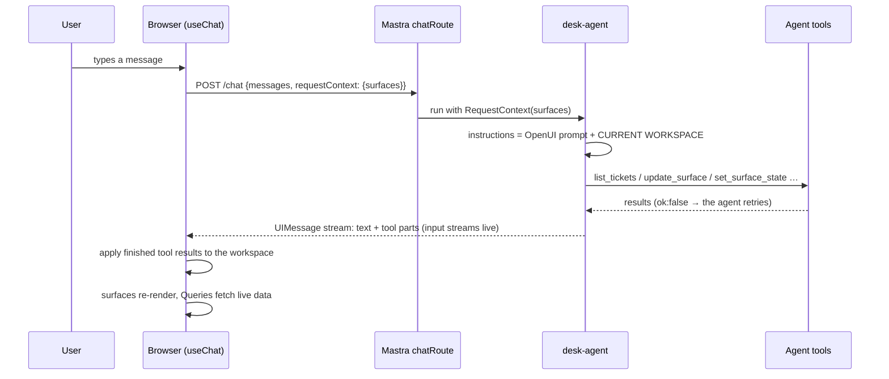
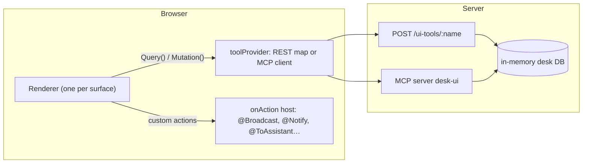
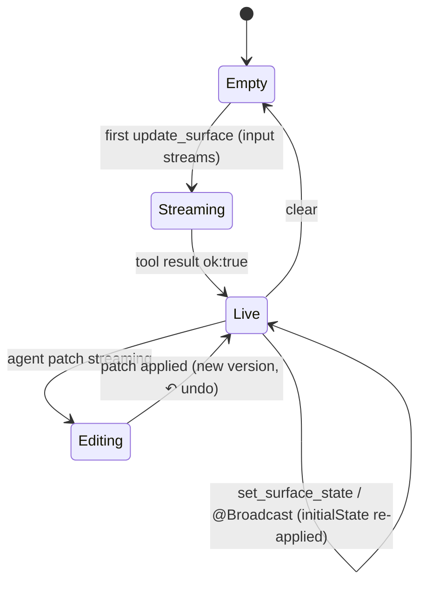
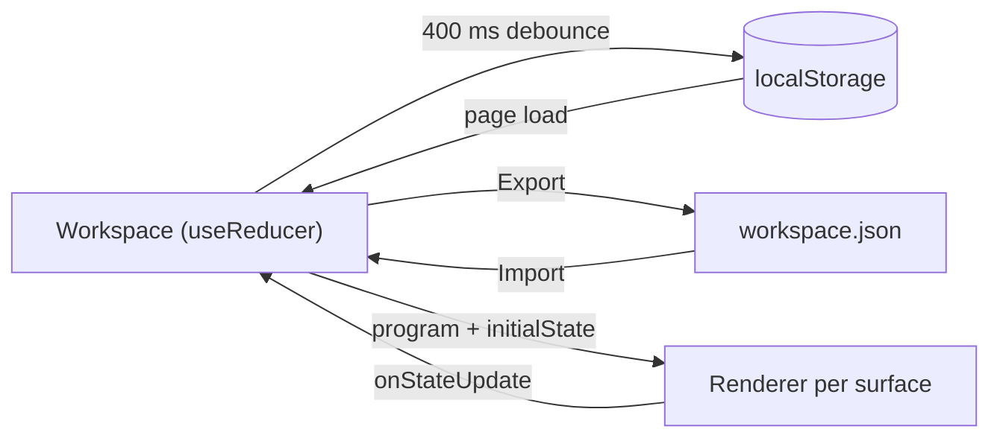

# Architecture

The demo is a pnpm workspace with three packages:

| Package | Runs in | Role |
| --- | --- | --- |
| `client/` | browser (Vite, React 19) | chat UI, surfaces, workspace state, component library |
| `server/` | Node (`mastra dev`, port 4111) | the agent, its tools, UI-tool backend (REST + MCP), A2UI stream |
| `shared/` | both | Zod contracts, prompt options, protocol helpers, program validation |

`shared/` is a convenience, not a requirement. See
[No shared client/server package](porting/no-shared-package.md).

## Request flow: one chat turn

The agent never sends HTML or React. It sends **OpenUI Lang patches** and **state
values** through tools. The browser applies them to its own copy of the workspace.
Details: [Live UI context](concepts/workspace-context.md),
[Agent edits surfaces](concepts/agent-edits.md),
[Applying tool results](concepts/tool-results.md).

## Data flow: programs call tools directly

Once a surface is mounted, it needs no model call to work. Filters, tabs, forms and
mutations run between the browser and the tool backend. See
[UI-side tools](concepts/ui-tools.md) and [Custom actions](concepts/custom-actions.md).

## Surface lifecycle

## Persistence

See [Persist & resume](concepts/persistence.md).

## File map

### `client/src`

| Folder | Purpose |
| --- | --- |
| `App.tsx`, `main.tsx` | providers, layout of the four surfaces, DevTools mount |
| `surfaces/` | `SurfaceView` (one long-lived `<Renderer>` per surface), frame with undo / source / clear, error reporter |
| `workspace/` | workspace type, reducer, serializer, localStorage + file storage, templates |
| `chat/` | `useChat` wiring, transport, message and tool-call views, inline UI |
| `chat/tool-results/` | one applier per agent tool + registry |
| `actions/` | `onAction` dispatcher, toasts, theme |
| `actions/handlers/` | one host handler per action + typed registry |
| `openui/components/` | the hand-written component library (layout, content, data, charts, inputs) |
| `openui/functions/`, `openui/actions/` | custom functions and custom action definitions |
| `openui/library.ts` | `createLibrary`: components, groups, functions, actions |
| `openui/tool-provider/` | REST function map, MCP client, browser-only tools |
| `artifacts/` | artifact card, side panel, viewer context |
| `a2ui/` | A2UI incident panel and its extended library |
| `debug/` | event log and app events on the observability bus |
| `layout/` | header (templates, export/import), dock tabs, error boundary |

### `server/src`

| Folder | Purpose |
| --- | --- |
| `mastra/index.ts` | Mastra instance: agent, MCP server, routes, CORS |
| `mastra/agents/` | `desk-agent`: model, instructions function, tools |
| `mastra/prompt/` | static system prompt + the dynamic CURRENT WORKSPACE section |
| `mastra/tools/` | `update_surface`, `set_surface_state`, `publish_artifact`, agent-side data tools |
| `mastra/request-context.ts` | read and update the surfaces inside one request |
| `mastra/routes/` | `/ui-tools/:name`, A2UI SSE + action routes |
| `mastra/mcp/` | the same UI tools as an MCP server |
| `ui-tools/` | handlers per contract + input validation |
| `db/` | deterministic seed and an in-memory ticket store |
| `a2ui/` | the A2UI incident session and its programs |

### `shared/src`

| Folder | Purpose |
| --- | --- |
| `surfaces.ts` | surface ids, titles and purposes (also used in the prompt) |
| `ui-tools/` | Zod contracts for every UI tool; MCP-style descriptors |
| `prompt/` | preamble, extra rules, validated examples, prompt options |
| `protocol/` | chat request extras, action-turn encoding |
| `program/` | `applyPatch` (mergeStatements), `validateProgram`, `declaredState` |
| `domain/` | ticket and activity schemas |

### `scripts/`

| File | Purpose |
| --- | --- |
| `check-programs.ts` | parses prompt examples and templates against the spec |
| `check-tool-results.ts` | checks the tool-result pipeline applies each call once |
| `print-prompt.ts` | prints the full system prompt |
