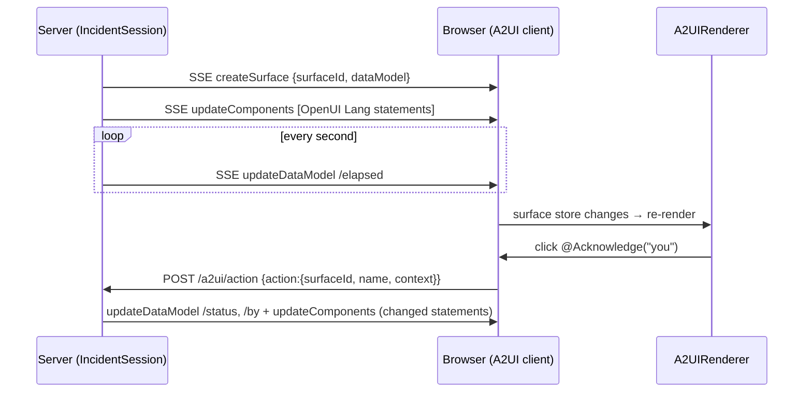

# A2UI

!!! abstract "In one line"
    A server-driven surface: the agent pushes A2UI envelopes over a stream (create, update components, update data, delete), the browser renders them with an OpenUI library, and clicks go back as `action` envelopes.

**Adopt alone?** Yes. It is isolated from chat, workspace and the other surfaces · **Effort** M · **Touches** client, server

## The problem

The other surfaces in the demo change when the user chats: the agent patches a program through a tool call during a turn. Some UIs need the opposite: the server decides what to show and updates it on its own clock. Think of an incident console, a job monitor or a step-by-step wizard run by a backend process.

A2UI is a protocol for that: a stateful, two-way message stream between an agent and a renderer. `@openuidev/a2ui` implements it with one change: component payloads are OpenUI Lang statements.

## How the demo does it

Dock → **"A2UI live incident"** shows a simulated incident with a running clock and Acknowledge / Resolve / Restart buttons.



**1. Statements read the data model as `$variables`** ([`server/src/a2ui/incident-program.ts`](https://github.com/asafmor/openui-desk/blob/main/server/src/a2ui/incident-program.ts)). A data-model key `elapsed` is `$elapsed`, so updating data re-renders without resending statements:

```ts
export const INITIAL_STATEMENTS = [
  "root = Stack([card])",
  'card = Card([head, IncidentClock($elapsed, "since detection"), TextContent($summary, "muted"), timeline, actions], "Live incident (A2UI)")',
  // …
  'actions = Buttons([Button("Acknowledge", @Acknowledge("you"))])',
];
```

**2. The server session sends envelopes** ([`server/src/a2ui/incident-session.ts`](https://github.com/asafmor/openui-desk/blob/main/server/src/a2ui/incident-session.ts)):

```ts
this.send({ version: V, createSurface: { surfaceId: this.surfaceId, dataModel: { title: "…", status: "open", elapsed: 0, by: "", summary: "…" } } });
this.send({ version: V, updateComponents: { surfaceId: this.surfaceId, components: INITIAL_STATEMENTS } });
this.timer = setInterval(() => this.set("/elapsed", ++this.elapsed), 1000);
// …
private set(path: string, value: unknown) {
  this.send({ version: V, updateDataModel: { surfaceId: this.surfaceId, path, value: value as never } });
}
```

`Restart` sends `deleteSurface`, then starts a new surface with a fresh id.

**3. Transport: SSE down, POST up** ([`server/src/mastra/routes/a2ui-routes.ts`](https://github.com/asafmor/openui-desk/blob/main/server/src/mastra/routes/a2ui-routes.ts)). Both are plain Mastra `registerApiRoute` routes. Incoming actions are validated with the package's Zod schema, because the browser is untrusted:

```ts
const parsed = actionMessageSchema.safeParse(await c.req.json());
if (!parsed.success) return c.json({ issues: parsed.error.issues }, 400);
const { surfaceId, name, context } = parsed.data.action;
```

**4. The browser feeds envelopes into a client and renders it** ([`client/src/a2ui/IncidentPanel.tsx`](https://github.com/asafmor/openui-desk/blob/main/client/src/a2ui/IncidentPanel.tsx)):

```ts
const c = createA2UIClient({
  schema: incidentLibrary.toJSONSchema(),
  rootName: incidentLibrary.root,
  onMessage: (msg) => {
    if ("action" in msg) postAction(msg);
    else console.warn("A2UI renderer message", msg);
  },
});
const source = new EventSource(`${SERVER_URL}/a2ui/stream`);
source.onmessage = (e) => void c.process(JSON.parse(e.data));
// …
return <A2UIRenderer client={client} surfaceId={surfaceId} library={incidentLibrary} />;
```

**5. A protocol-specific library** ([`client/src/a2ui/incident-library.tsx`](https://github.com/asafmor/openui-desk/blob/main/client/src/a2ui/incident-library.tsx)). `library.extend` derives a new library from the main one: it adds `IncidentClock` (allowed only inside `Card`), overrides `Badge` with a pulsing one, removes `HtmlFrame` and `Modal`, and adds the actions the server listens for (`Acknowledge`, `Resolve`, `Restart`). The main library is unchanged.

## Port it to your app

1. **Install** `@openuidev/a2ui` on both sides (the server uses its types and schemas).
2. **Pick a library** for the surface: your main one, or one derived with `library.extend(...)` at module scope.
3. **Server:** open a stream (SSE, WebSocket or anything ordered) and send `createSurface`, then `updateComponents` with OpenUI Lang statements, then `updateDataModel` as data changes. Use `"v1.0"` as `version`.
4. **Server:** accept `action` envelopes, validate them with `actionMessageSchema`, and route them to the session that owns `surfaceId`.
5. **Client:** `createA2UIClient({ schema: lib.toJSONSchema(), rootName: lib.root, onMessage })`, call `client.process(envelope)` for each incoming message, and send `action` messages from `onMessage` to your server.
6. **Client:** render `<A2UIRenderer client surfaceId library />`. Read the surface id from `client.getSurfaces()` when the server chooses it.

## A2UI or OpenUI Lang surfaces?

| | OpenUI Lang surface (rest of the demo) | A2UI surface |
|---|---|---|
| Who changes it | The agent, during a chat turn, through a tool | The server, any time, over a stream |
| What is persisted | Program + state, by the host | Nothing by default; the server owns the session |
| Data updates | Queries re-fetch; the agent can set `$state` | `updateDataModel` pushes values directly |
| User actions | Host `onAction`, `@Run` mutations, chat turns | `action` envelopes to the agent/server |
| Fits | Long-lived, user-shaped dashboards and tools | Live, server-shaped flows; interop with other A2UI agents |

You can mix them, as the demo does: A2UI for one live panel, OpenUI Lang surfaces elsewhere.

## Variations

- **You already have your own chat/history.** No impact; A2UI doesn't go through chat.
- **No shared package.** No impact; the statements live on the server and the library on the client. Keep the action names in sync by hand or with a shared constant.
- **The agent should drive it.** Let a Mastra tool or workflow push envelopes into the session instead of a timer.

## Pitfalls

!!! warning "Bind `subscribe`"
    `client.subscribe` is a class method. Passing it unbound (for example straight to `useSyncExternalStore`) loses `this` and throws an error about private fields. Wrap it: `(onChange) => client.subscribe(onChange)`.

- **One client per connection.** React StrictMode runs effects twice; a second `createSurface` with an existing id collides. The demo creates a new client and a unique surface id per connection, and calls `client.dispose()` on cleanup.
- **The server picks the surface id**, and it can change (Restart). Read it from the client's store rather than hard-coding it.
- **Validate everything from the browser** with the package's schemas before acting on it.
- **Derive libraries at module scope.** Parsers are cached by library identity; building one during render re-parses every time.

## Related

- [Your own component library](component-library.md): `library.extend`, slots and overrides.
- [Restricting components per surface](restricted-components.md)
- [Custom actions & the host](custom-actions.md)
