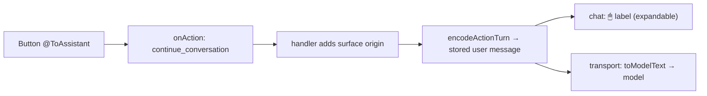

# Clicks that talk to the agent

!!! abstract
    A button in generated UI can send a chat turn to the agent, carrying the clicked label, the form values and extra context. The demo stores that turn in OpenUI's message format so it can be shown compactly and sent to the model as plain text.

**Adopt alone?** Yes · **Effort** S · **Touches** client (plus one prompt rule)

## The problem

Generated UI often needs the agent's judgement: "Summarize this ticket", "Explain these charts", or a form whose answer the agent should act on. The click has to become a user message, and the model has to know which values were on screen.

## How the demo does it

### 1. Two ways a click becomes a turn

```
Button("Summarize", @ToAssistant("Summarize this ticket and suggest a next step", {ticketId: $ticketId}), "secondary")
Button("Ask")                      ← no action: sends its label to the assistant
```

Both make the Renderer emit a `continue_conversation` event (`BuiltinActionType.ContinueConversation`) to `<Renderer onAction>`. The event carries:

| Field | Value |
| --- | --- |
| `humanFriendlyMessage` | The message (or the button label) |
| `params.context` | The second argument of `@ToAssistant`, if any |
| `formState` | The raw form state at the time of the click |

For primary Buttons, `useRunAction` validates the enclosing form first, so a turn is not sent with invalid inputs ([`client/src/openui/components/inputs/useRunAction.ts`](https://github.com/asafmor/openui-desk/blob/main/client/src/openui/components/inputs/useRunAction.ts)).

### 2. The host adds where the click happened

[`client/src/actions/handlers/continue-conversation.ts`](https://github.com/asafmor/openui-desk/blob/main/client/src/actions/handlers/continue-conversation.ts):

```ts
export const handleContinueConversation: ActionHandler<"continue_conversation"> = (event, { origin, host }) => {
  const ctx = event.params?.context;
  const context = ctx && typeof ctx === "object" && !Array.isArray(ctx) ? { ...ctx, surface: origin } : { value: ctx, surface: origin };
  host.sendActionTurn({ message: event.humanFriendlyMessage, formState: event.formState, context });
};
```

`origin` is "canvas", "dock", "chat", "artifact:…" — whichever Renderer the click came from ([Custom actions & the host](custom-actions.md)).

### 3. Stored with OpenUI's message markers

[`shared/src/protocol/action-message.ts`](https://github.com/asafmor/openui-desk/blob/main/shared/src/protocol/action-message.ts) writes the turn with `buildMessage` from `@openuidev/lang-core`:

```ts
export function encodeActionTurn({ message, formState, context }: ActionTurn): string {
  const payload: unknown[] = [`User clicked: ${message}`, formState ?? {}];
  if (context !== undefined) payload.push(context);
  return buildMessage({ content: message, context: payload });
}
```

The stored text looks like:

```
]]>openui:content
Summarize this ticket and suggest a next step
]]>openui:context
["User clicked: Summarize this ticket and suggest a next step",{},{"ticketId":"T-1006","surface":"dock"}]
```

The chat shows it as a collapsible "🖱 Summarize…" line; `decodeActionTurn` (which uses `parseMessage`) splits it back ([`client/src/chat/MessageView.tsx`](https://github.com/asafmor/openui-desk/blob/main/client/src/chat/MessageView.tsx)).

### 4. Plain text for the model

The model gets the markers stripped. The chat transport converts user turns at send time ([`client/src/chat/chat-transport.ts`](https://github.com/asafmor/openui-desk/blob/main/client/src/chat/chat-transport.ts)):

```ts
export function toModelText(text: string): string {
  if (!text.includes("]]>openui:")) return text;
  const { message, context } = decodeActionTurn(text);
  return context == null ? message : `${message}\ncontext and form values = ${JSON.stringify(context)}`;
}
```

A prompt rule tells the model what that suffix means ([`shared/src/prompt/rules.ts`](https://github.com/asafmor/openui-desk/blob/main/shared/src/prompt/rules.ts)): *"Every user message may end with "context and form values = [...]": that turn came from a click in a surface…"*.



## Port it to your app

1. In `onAction`, handle `continue_conversation`: take `humanFriendlyMessage`, `formState` and `params.context`.
2. Send a user message through your chat. Encoding it with `buildMessage({ content, context })` is optional but gives you one string that keeps the structure.
3. Before the model sees it, turn it into readable text (`parseMessage` + a "context and form values = …" line), and add one prompt rule that explains that line.
4. Optionally show such turns differently in your chat UI.

## Variations

- **You already have your own chat/history.** Call your own "send message" function from the handler. If your history is stored server-side, convert the markers on the server instead of in the transport.
- **No shared client/server package.** `buildMessage`/`parseMessage` are in `@openuidev/lang-core`, which both sides can install; only the 10-line encode/decode helper is shared code.
- **Single surface.** Drop the `surface` field from the context.
- **Plain text only.** You can skip the markers and send `"Summarize…\ncontext = {…}"` directly. You lose the compact display and a stable format for stored history.

## Pitfalls

- **Huge form state.** `formState` contains every field; trim it if forms are large.
- **Unvalidated forms.** Validate before sending; the reference Button does, and so does the demo's `useRunAction`.
- **Clicks during streaming.** The demo disables Buttons while a program streams (`useIsStreaming`).

## Related

- [Custom actions & the host](custom-actions.md)
- [Inline UI in chat](inline-ui.md)
- [Live UI context for the agent](workspace-context.md)
- [Persist & resume](persistence.md)
