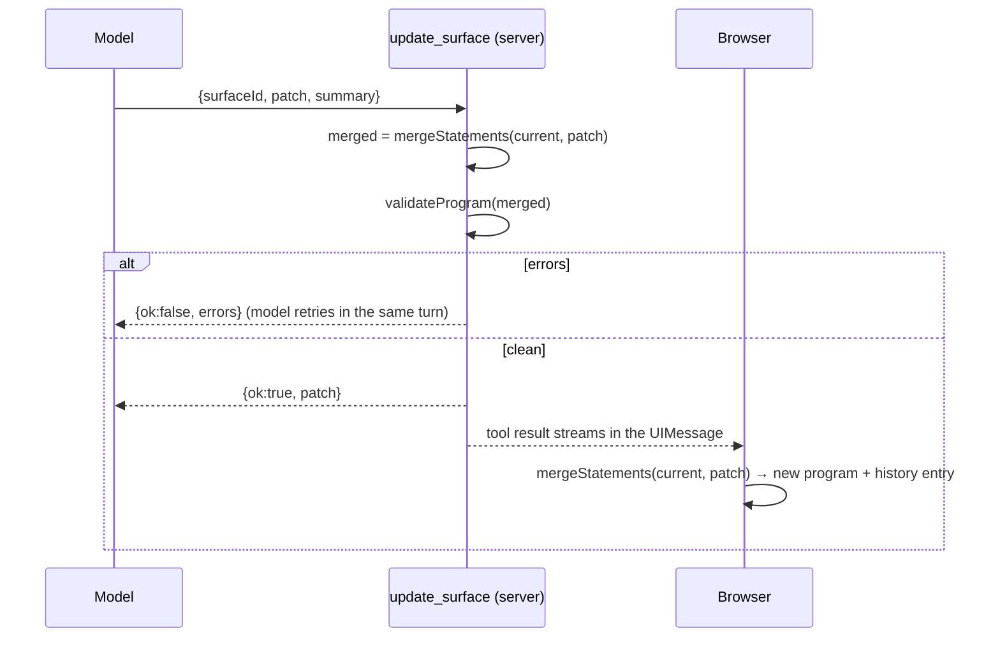

# Agent edits surfaces

!!! abstract
    The agent changes a long-lived UI by sending a small **patch** (only the changed statements) through a tool. The server merges and validates it before accepting it; the browser applies the same merge.

**Adopt alone?** Yes; it works best with [live UI context](workspace-context.md) so the agent sees what it patches · **Effort** M · **Touches** server, client, prompt

## The problem

A dashboard that lives for weeks should not be regenerated on every request. Regenerating:

- costs tokens and time proportional to the whole program, not the change;
- risks the model "forgetting" parts the user relied on;
- makes small regressions easy to miss in a long program.

You want the agent to say *"replace the `overviewTab` statement and add `priorityPie`"*, and nothing else.

## How the demo does it

OpenUI Lang programs are a list of named statements (`name = Expression`). That makes a **merge by name** possible. OpenUI ships it as `mergeStatements(existing, patch)` in `@openuidev/lang-core`, and its prompt generator teaches the model to write patches when you pass `editMode: true`.



### 1. Teach the model to patch

The prompt option is one flag ([`shared/src/prompt/prompt-options.ts`](https://github.com/asafmor/openui-desk/blob/main/shared/src/prompt/prompt-options.ts)):

```ts
export const promptOptions: PromptOptions = {
  // …
  editMode: true, // answer with changed statements only (patches)
};
```

It adds an "Edit Mode" section to the generated prompt: *same name = replace, new name = append, output only statements that changed*. The demo adds rules that route patches through a tool instead of chat fences ([`shared/src/prompt/rules.ts`](https://github.com/asafmor/openui-desk/blob/main/shared/src/prompt/rules.ts)):

```ts
"SURFACES: change a surface ONLY by calling update_surface({surfaceId, patch}). …",
"An EMPTY surface needs a complete program whose first line is root = Stack([...]).",
"To delete a statement in a patch write `name = null`, or re-declare its parent without it.",
```

### 2. One merge function, used on both sides

[`shared/src/program/apply-patch.ts`](https://github.com/asafmor/openui-desk/blob/main/shared/src/program/apply-patch.ts):

```ts
import { mergeStatements } from "@openuidev/lang-core";

export function applyPatch(current: string, patch: string): string {
  return mergeStatements(current, patch);
}
```

What `mergeStatements` does:

| Patch contains | Result |
| --- | --- |
| A statement with an existing name | Replaces it |
| A new name | Appended |
| `name = null` | Deletes the statement |
| Markdown fences around the code | Stripped |
| Anything, with an empty `existing` | The patch, normalized (a first program) |

Statements that `root` can no longer reach are dropped; `$state` declarations are kept.

### 3. Validate before accepting

The tool merges against the program the browser sent with the request, then parses the result with the same parser the Renderer uses ([`server/src/mastra/tools/update-surface.ts`](https://github.com/asafmor/openui-desk/blob/main/server/src/mastra/tools/update-surface.ts)):

```ts
execute: async ({ surfaceId, patch, summary }, context) => {
  const current = getSurfaces(context?.requestContext).find((s) => s.id === surfaceId)?.program ?? "";
  const merged = applyPatch(current, patch);
  const errors = validateProgram(merged);
  if (errors.length > 0) {
    return { ok: false, surfaceId, errors, note: "Nothing was applied. Fix the errors and call update_surface again." };
  }
  setSurfaceProgram(context?.requestContext, surfaceId, merged); // a 2nd patch this turn builds on it
  return { ok: true, surfaceId, patch, summary };
},
```

`validateProgram` ([`shared/src/program/validate-program.ts`](https://github.com/asafmor/openui-desk/blob/main/shared/src/program/validate-program.ts)) reports parser errors, a missing root, unclosed strings, unresolved references and orphaned statements. See [Fixing errors with the agent](self-correction.md).

### 4. The browser applies the same merge

When the tool part reaches `output-available` with `ok: true`, the browser merges the **patch** (not a full program) into its copy ([`client/src/chat/tool-results/update-surface.ts`](https://github.com/asafmor/openui-desk/blob/main/client/src/chat/tool-results/update-surface.ts)). Because `mergeStatements` is deterministic, server and browser end with the same text. The reducer keeps the previous program in `history` (max 30), which powers the ↶ Undo button ([`client/src/workspace/workspace-reducer.ts`](https://github.com/asafmor/openui-desk/blob/main/client/src/workspace/workspace-reducer.ts)). How results are applied exactly once is covered in [Applying tool results](tool-results.md).

### 5. Preview while the model types

The AI SDK streams tool input as it is generated (`input-streaming`, partial `input`). The demo uses that only for an **empty** surface: its first program renders live. An existing surface keeps showing its current program until the patch is complete ([`client/src/chat/pending-patches.ts`](https://github.com/asafmor/openui-desk/blob/main/client/src/chat/pending-patches.ts), [`client/src/surfaces/SurfaceView.tsx`](https://github.com/asafmor/openui-desk/blob/main/client/src/surfaces/SurfaceView.tsx)):

```ts
const firstStream = !surface.program && pendingPatch !== undefined;
const response = firstStream ? pendingPatch : surface.program;
```

!!! warning "Never merge a half-written patch"
    A partial patch may contain a half-written `root`. Merging it makes everything else look unreachable, and `mergeStatements` drops it.

## Port it to your app

1. Turn on `editMode: true` in the `promptOptions` you pass to `generateSystemPrompt` (the full prompt; see [Prompt generation](prompt.md)).
2. Send the agent the **current program** of the surface it should patch. Without it, the model has nothing to patch against ([Live UI context](workspace-context.md)).
3. Add a tool, e.g. `update_surface({ surfaceId, patch, summary })`, that merges with `mergeStatements`, validates with `createParser(...).parse()`, and returns `ok:false` + errors or `ok:true` + the patch.
4. In the browser, when the tool result arrives, run `mergeStatements(currentProgram, patch)` and store the result. Keep the previous program if you want undo.
5. Add one rule to your prompt that says patches go through the tool, not chat.

## Variations

- **Single surface.** Drop `surfaceId`; the rest is the same.
- **You already have your own chat/history.** Apply the patch wherever you already process tool results (see [Applying tool results](tool-results.md)). If your history lives on the server, you can store the merged program on the server inside the tool and let the client fetch it, instead of merging in the browser.
- **No shared client/server package.** Only the server must validate. The browser needs `mergeStatements`, which is in `@openuidev/lang-core`; both sides install that package, so there is nothing to share but the function call.
- **No tool, chat-only.** OpenUI's default edit-mode design puts the patch in a fenced block in the assistant reply. That works for one program per conversation; with several surfaces, a tool with `surfaceId` is clearer.

## Pitfalls

- **Full rewrites.** Without `editMode`, models re-emit the whole program. Patches also fail silently if the model renames statements; the generated prompt says "reuse existing statement names exactly".
- **Patching a `$variable` default does not change what the user sees.** Saved state wins over defaults. Use [Agent drives live state](agent-state.md) for that.
- **Positional props.** Programs are positional. If you reorder or remove component props, old programs break. Only append optional props.
- **Merge order.** Merge only after the tool input is complete (`input-available` or later).

## Related

- [Live UI context for the agent](workspace-context.md)
- [Fixing errors with the agent](self-correction.md)
- [Applying tool results](tool-results.md)
- [Agent drives live state](agent-state.md)
- [Persist & resume](persistence.md)
