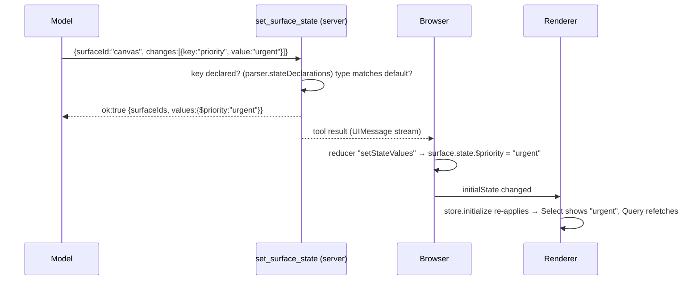

# Agent drives live state

!!! abstract
    A tool lets the agent set `$variables` a surface already declares (filters, tab, selected row, open modal, form inputs) without changing its program. The UI reacts live, the same way it does for a user click.

**Adopt alone?** Needs: [persisted surface state](persistence.md) (`initialState` + `onStateUpdate`) and [live UI context](workspace-context.md) · **Effort** S · **Touches** server, client, prompt

## The problem

The user asks: *"show me only the urgent open tickets"*. The table already has Status and Priority filters bound to `$status` and `$priority`. The agent should just set them.

Rewriting the program does not work. A patch like `$priority = "urgent"` changes only the **default**. The Renderer's saved state already holds `$priority`, and saved values win:

```js
// lang-core store.initialize(defaults, persisted), simplified
for (const key of Object.keys(persisted)) state.set(key, persisted[key]);        // saved values always applied
for (const key of Object.keys(defaults)) if (!state.has(key)) state.set(key, defaults[key]);
// a changed default only replaces a value that was never persisted ("pristine")
```

Since the demo saves the state snapshot on every change, every key ends up persisted, so the table would not move.

## How the demo does it



### 1. The tool validates against what the program declares

The parser already returns each `$variable` with its default ([`shared/src/program/validate-program.ts`](https://github.com/asafmor/openui-desk/blob/main/shared/src/program/validate-program.ts)):

```ts
export function declaredState(program: string): Record<string, unknown> {
  return parser.parse(program).stateDeclarations ?? {};
}
```

The tool rejects keys nothing declares and values whose type differs from the default ([`server/src/mastra/tools/set-surface-state.ts`](https://github.com/asafmor/openui-desk/blob/main/server/src/mastra/tools/set-surface-state.ts)):

```ts
inputSchema: z.object({
  surfaceId: z.enum([...SURFACE_IDS, "all"]),
  // An array of {key, value} instead of a record: strict tool schemas (OpenAI) reject open-ended objects.
  changes: z.array(Change).min(1),
  summary: z.string(),
}),
execute: async ({ surfaceId, changes, summary }, context) => {
  // …for each change:
  const name = `$${key.replace(/^\$/, "")}`;
  const declaring = targets.filter((s) => name in declaredState(s.program));
  if (declaring.length === 0) { errors.push({ code: "undeclared", message: `${name} is not declared in ${surfaceId}.`, hint: `Declared: …` }); continue; }
  const expected = typeof declaredState(declaring[0].program)[name];
  if (expected !== "undefined" && expected !== "object" && typeof value !== expected) { errors.push({ code: "type-mismatch", … }); continue; }
  values[name] = value;
  // …
  if (errors.length > 0) return { ok: false, surfaceId, errors, note: "Nothing was applied. Fix and call again." };
  return { ok: true, surfaceIds, values, summary };
},
```

`ok:false` with a hint ("Declared: $tab, $status, …") lets the model correct itself in the same turn. `surfaceId: "all"` sets the key in every surface, like the `@Broadcast` action.

### 2. The browser writes into saved state

The applier turns the result into a reducer action ([`client/src/chat/tool-results/set-surface-state.ts`](https://github.com/asafmor/openui-desk/blob/main/client/src/chat/tool-results/set-surface-state.ts)):

```ts
export const applySetSurfaceState: ToolResultApplier = (output) => {
  const out = output as SetSurfaceStateOutput | undefined;
  if (!out?.ok || !out.values) return [];
  return [{ type: "setStateValues", surfaceIds: (out.surfaceIds ?? []).filter(isSurfaceId), values: out.values }];
};
```

The reducer merges the values into `surface.state` — the object each surface passes as `<Renderer initialState>`. This is the same `writeState` helper the [`@Broadcast`](cross-surface.md) action uses. The `toolCall` envelope makes sure a reload does not re-apply old values over newer user changes ([Applying tool results](tool-results.md)).

### 3. One prompt rule

From [`shared/src/prompt/rules.ts`](https://github.com/asafmor/openui-desk/blob/main/shared/src/prompt/rules.ts):

> UI STATE: to change what a surface currently SHOWS (filter, search, tab, selected ticket, open a modal, prefill inputs) call set_surface_state(…). Prefer it over update_surface whenever the program already declares a $variable for it: patching a $variable's default does NOT change a live surface, because its saved $state wins. Use values the program accepts (e.g. the SelectItem values).

Result with the real model: "Show me only the urgent open tickets in the canvas table" → one call setting `$tab`, `$status`, `$priority` in about 6–8 s; the table showed only urgent rows.

## Port it to your app

1. Make sure each surface's Renderer uses `initialState` (from your store) and `onStateUpdate` (back to your store). See [Persist & resume](persistence.md).
2. Send the agent each surface's program and its `$` state ([Live UI context](workspace-context.md)), so it knows which variables exist.
3. Add a server tool `set_surface_state({ surfaceId, changes: [{key, value}], summary })`. Validate keys with `createParser(schema, root).parse(program).stateDeclarations`.
4. On the client, when the result arrives, merge `values` into that surface's stored state. React re-renders the Renderer with the new `initialState`, and the store re-applies changed values.
5. Add the prompt rule above.

## Variations

- **Single surface.** Drop `surfaceId` and `"all"`.
- **You already have your own chat/history.** Apply the result wherever you process tool results. Record the `toolCallId` so replaying history does not overwrite newer user changes.
- **No shared client/server package.** The server needs a parser built from your library spec JSON (`createParser(spec.schema, spec.root)`); the client needs nothing new.
- **Client-side tool.** You can define the tool without `execute` and run it in the browser (AI SDK `onToolCall` + `addToolOutput`). That lets you return the state the browser applied, at the cost of a resume round-trip. The demo keeps it server-side so it is replay-safe like the other tools.

## Pitfalls

- **Values must match the options.** The type check catches `"true"` vs `true`, but not `"urgnt"` vs `"urgent"`. A Select silently shows nothing for an unknown value.
- **Unmounted parts.** Setting `$showEdit = true` opens a modal only if the modal's statement is reachable from root.
- **Don't fake actions with state.** State can't run a Mutation. See [Proposals](proposals.md).

## Related

- [Persist & resume](persistence.md)
- [Cross-surface control](cross-surface.md)
- [Agent edits surfaces](agent-edits.md)
- [Applying tool results](tool-results.md)
- [Proposals (human in the loop)](proposals.md)
