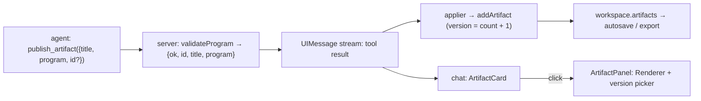

# Artifacts

!!! abstract
    An artifact is a tool result plus a renderer you supply: a standalone document (here, an OpenUI program) the agent publishes, the user opens in a side panel, and the app keeps with versions. It is an app convention, not a Mastra or OpenUI-core primitive.

**Adopt alone?** Yes; it reuses the pattern from [Applying tool results](tool-results.md) · **Effort** S–M · **Touches** server, client

## The problem

Some outputs are meant to be kept and reopened — a weekly SLA report, an incident summary — but are neither a chat reply (it scrolls away) nor a long-lived surface (it is not a fixed slot that keeps changing).

## What OpenUI and Mastra provide

| | Artifacts? |
| --- | --- |
| **Mastra** | No artifact concept for chat UIs. The word appears in its A2A docs for remote-agent task outputs. To Mastra, `publish_artifact` is an ordinary tool. |
| **OpenUI core** (`lang-core`, `react-lang`) | No. You render the program with `Renderer` like any other. |
| **OpenUI `AgentInterface`** (`@openuidev/react-ui`) | A convention with UI: `defineArtifactRenderer` (inline preview + full view), a side panel, and an artifact browser backed by a `ChatStorage.artifact` interface (`list`, `get`, `update`) that **you** implement. See the [OpenUI artifacts docs](https://www.openui.com/docs/agent/core-concepts/artifacts). |

The demo uses `useChat`, not `AgentInterface`, so it builds the same pattern by hand. (`@openuidev/react-ui` is not installed in the demo.)

## How the demo does it



### 1. The tool validates and mints an id

[`server/src/mastra/tools/publish-artifact.ts`](https://github.com/asafmor/openui-desk/blob/main/server/src/mastra/tools/publish-artifact.ts):

```ts
inputSchema: z.object({
  title: z.string(),
  program: z.string().describe("Complete OpenUI Lang program, no markdown fences"),
  id: z.string().optional().describe("Existing artifact id to revise"),
}),
execute: async ({ title, program, id }) => {
  const errors = validateProgram(program);
  if (errors.length > 0) return { ok: false, errors };
  return { ok: true, id: id ?? `art-${crypto.randomUUID().slice(0, 8)}`, title, program };
},
```

The server stores nothing. The result reaches the browser because the AI SDK UIMessage stream carries tool **results** (Chat Completions streams do not).

### 2. The browser stores versions

The applier ([`client/src/chat/tool-results/publish-artifact.ts`](https://github.com/asafmor/openui-desk/blob/main/client/src/chat/tool-results/publish-artifact.ts)) dispatches `addArtifact`; the reducer numbers versions per id:

```ts
case "addArtifact": {
  const versions = ws.artifacts.filter((a) => a.id === action.artifact.id).length;
  const artifact = { ...action.artifact, version: versions + 1, at: new Date().toISOString() };
  return { ...ws, artifacts: [...ws.artifacts, artifact] };
}
```

Passing an existing `id` to the tool publishes a new version. Old versions are kept; nothing is deleted.

### 3. Card in chat, panel on demand

[`ArtifactCard.tsx`](https://github.com/asafmor/openui-desk/blob/main/client/src/artifacts/ArtifactCard.tsx) shows the title and version count; clicking opens [`ArtifactPanel.tsx`](https://github.com/asafmor/openui-desk/blob/main/client/src/artifacts/ArtifactPanel.tsx), which renders the chosen version with a fresh `<Renderer>`. Its `Query()` calls fetch live data each time it opens.

### Artifacts vs surfaces

| | Surface | Artifact |
| --- | --- | --- |
| Where it shows | Fixed slot, always mounted | Side panel, opened on demand |
| How it changes | Patches (`update_surface`), undo | A complete program per version; versions never change |
| UI state (filters, tabs) | Saved (`initialState` / `onStateUpdate`) | Not saved; resets on each open |
| Agent sees it each turn | Yes (CURRENT WORKSPACE section) | Only through chat history |
| `@Broadcast` target | Yes | No |
| Stored | `workspace.surfaces` | `workspace.artifacts` (browser only) |

## Port it to your app

1. Add a tool (`publish_artifact` or similar) whose **result** carries `{ id, title, version or content }`. Validate OpenUI content with `createParser(...).parse()` before returning `ok:true`.
2. Use a chat stream that carries tool results (AI SDK UIMessage, LangGraph, Responses SSE…).
3. When the result arrives, store it (client store or server DB) keyed by id, with a version number.
4. Render a preview in the chat and a full view (`<Renderer response={content} library={…}>`) in a panel.

## Variations

- **You already have your own chat/history.** If you use OpenUI's `AgentInterface`, use `defineArtifactRenderer` and implement `ChatStorage.artifact`. Otherwise apply the result where you handle tool results.
- **Server-side storage.** Write the artifact inside the tool's `execute` (your DB, keyed by user/thread) and return its id. Then artifacts survive across devices and do not depend on the chat.
- **No shared client/server package.** Only the server validates; the client only renders.
- **Non-OpenUI content.** An artifact can be Markdown, HTML or JSON; only the renderer changes.

## Pitfalls

### Discovery when the chat is gone

In the demo the chat card is the only way to open an artifact. If the chat were cleared, the artifacts would still be in `workspace.artifacts`, but nothing would list them.

!!! note "Recipe — not in the demo: an artifacts menu"
    A header menu that lists `workspace.artifacts` (unique ids, latest version) and calls the panel's `setOpenId(id)`. About 20 lines; it reuses `ArtifactViewerContext`.

!!! note "Recipe — not in the demo: a server artifact store"
    Store artifacts on the server inside `publish_artifact` and add `GET /artifacts` and `GET /artifacts/:id` routes (Mastra `registerApiRoute`). This makes them discoverable across workspaces and devices, and is what `ChatStorage.artifact` expects you to back.

### Other pitfalls

- **Partial input.** While the tool input streams, `input` is partial JSON. Render a preview only from the finished result.
- **State resets.** Artifacts do not save filter/tab state. Add `initialState`/`onStateUpdate` per artifact version if you need it.
- **Agent awareness.** The agent does not see artifacts in its context unless you send them; to revise one it relies on the id in chat history.

## Related

- [Applying tool results](tool-results.md)
- [Surface modeling](surfaces.md)
- [Persist & resume](persistence.md)
- [Inline UI in chat](inline-ui.md)
- [Persisting on the server](../porting/server-persistence.md)
