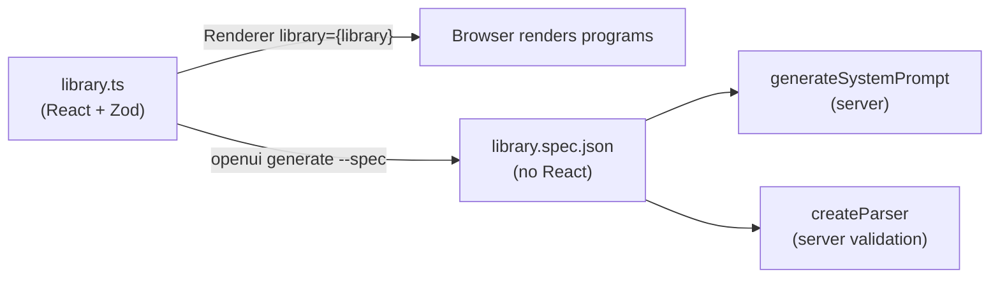

# Your own component library

!!! abstract
    Write every component yourself with `defineComponent` and plain React, so generated UI looks and behaves like the rest of your app. You don't need `@openuidev/react-ui`.

**Adopt alone?** Yes · **Effort** M · **Touches** client, prompt (through the generated spec)

## The problem

The model writes OpenUI Lang, and something has to turn `Kpi("Open", 15)` into pixels. OpenUI ships a ready-made library, but most apps already have a design system and a stylesheet. They want the model to use **their** components, with their names, props and accessibility rules, without a second UI kit in the bundle.

## How the demo does it

Every component is a small file under [`client/src/openui/components`](https://github.com/asafmor/openui-desk/tree/main/client/src/openui/components), styled by one plain CSS file. A component is a name, a description (shown to the model), a Zod props schema and a React renderer.

```tsx title="client/src/openui/components/content/Kpi.tsx"
export const Kpi = defineComponent({
  name: "Kpi",
  description: "Key metric: label, value, optional hint line and tone.",
  props: z.object({
    label: z.string(),
    value: z.union([z.string(), z.number()]),
    hint: z.string().optional(),
    tone: Tone.optional(),
  }),
  component: ({ props }) => {
    const loading = useIsQueryLoading();
    return (
      <div className={`ou-kpi ou-tone--${props.tone ?? "neutral"}`} aria-busy={loading}>
        {/* … */}
      </div>
    );
  },
});
```

[Source](https://github.com/asafmor/openui-desk/blob/main/client/src/openui/components/content/Kpi.tsx)

The **key order of `props` is the positional argument order** in OpenUI Lang. `Kpi("Open", stats.open, "refreshes every 30s")` fills `label`, `value`, `hint` in that order.

### The building blocks

| Need | API | Demo example |
| --- | --- | --- |
| Render nested children | `renderNode(props.children)` from the render props | [`Tabs.tsx`](https://github.com/asafmor/openui-desk/blob/main/client/src/openui/components/layout/Tabs.tsx) |
| Accept only certain children | `z.array(TabItem.ref)`, or a `z.union([...refs])` | `Tabs` items, `Card` children |
| A prop the model can bind to a `$variable` | `reactive(z.string().optional())` + `useStateField(name, props.value)` | `Tabs`, `Input`, `Select`, `Modal` |
| A prop that takes an action | `action()` | [`Button.tsx`](https://github.com/asafmor/openui-desk/blob/main/client/src/openui/components/inputs/Button.tsx) |
| Form state and validation | `FormNameContext`, `FormValidationContext`, `useCreateFormValidation`, `useFormValidation`, `parseStructuredRules` | [`Form.tsx`](https://github.com/asafmor/openui-desk/blob/main/client/src/openui/components/inputs/Form.tsx), [`useValidatedField.ts`](https://github.com/asafmor/openui-desk/blob/main/client/src/openui/components/inputs/useValidatedField.ts) |
| Behave well while the program streams | `useIsStreaming()` | `HtmlFrame`, inputs (disabled while streaming) |
| Dim while data loads | `useIsQueryLoading()` | `Kpi` |

### Bindable props

`reactive()` marks a prop as accepting a `$variable`. In the prompt it prints as `value?: $binding<string>`. Inside the component, `useStateField` returns a `{ value, setValue }` pair. When the model bound a variable, `setValue` writes it, and every expression and Query that reads it re-evaluates.

```ts title="client/src/openui/components/layout/Tabs.tsx"
props: z.object({
  items: z.array(TabItem.ref),
  value: reactive(z.string().optional()),
}),
component: ({ props, renderNode }) => {
  const field = useStateField("tabs", props.value);
  const items = props.items.filter(Boolean);
  const active = items.find((t) => t.props.value === field.value) ?? items[0];
  // …
},
```

One hook, `useValidatedField`, wraps `useStateField`, form validation and `useIsStreaming` for every input. Each input file stays about 30 lines.

### The library

`createLibrary` collects components, groups, functions and actions. `componentGroups` split the prompt's component list into titled sections with notes, which helps the model pick the right component.

```ts title="client/src/openui/library.ts"
export const library = createLibrary({
  id: LIBRARY_ID,
  root: "Stack", // programs start with root = Stack([...])
  components: [Stack, Card, Tabs, TabItem, Modal, TextContent, Badge, Kpi, /* … */],
  componentGroups: [
    { name: "Data", components: ["Table", "Col"],
      notes: ["Prefer Query() results + array pluck (rows.field) over hardcoded rows."] },
    // …
  ],
  functions: customFunctions,
  actions: customActions,
});
```

[Source](https://github.com/asafmor/openui-desk/blob/main/client/src/openui/library.ts)

### One library, two consumers



The server must not import React components, so the OpenUI CLI serializes the library into a JSON spec. The demo runs it as `pnpm generate`:

```bash
openui generate src/openui/library.ts --spec --out ../shared/generated/library.spec.json
```

## Port it to your app

1. Write one component with `defineComponent`: name, description, Zod props in argument order, React renderer. Reuse your existing design-system component inside it.
2. Add `reactive()` to any prop the model should bind to state, and read it with `useStateField`.
3. Collect the components with `createLibrary({ root, components, componentGroups })`.
4. Render with `<Renderer response={program} library={library} />`.
5. Generate the spec with the CLI (`openui generate <file> --spec --out <path>`) and give it to `generateSystemPrompt` on the server. See [Prompt generation](prompt.md).
6. Re-run step 5 whenever a component, prop, function or action changes. The demo runs it as the first step of `pnpm dev`.

## Variations

- **You already have your own chat and history.** No change. The library only concerns rendering and the prompt.
- **No shared client/server package.** The spec JSON is the only thing the server needs. Generate it in the client build and copy or publish it to the server, for example as a build artifact. See [No shared client/server package](../porting/no-shared-package.md).
- **Single surface.** Same library. To give different surfaces different components, see [Restricting components per surface](restricted-components.md).

## Pitfalls

!!! warning "Reuse the reference names for forms"
    The generated prompt's built-in sections (bindings, forms, tools) show examples that use OpenUI's reference names: `Form`, `FormControl`, `Input`, `Select`, `SelectItem`, `Button`, `TextContent`, `Stack`. If your library calls them something else, the model copies the examples and gets `unknown-component` errors. The demo keeps those names and their argument orders.

!!! warning "Props are positional: append only"
    Saved programs store arguments by position. Reordering or removing props makes old programs put values in the wrong place. Only append new **optional** props. The demo records `library=support-desk@1` in every saved surface so you can detect old programs. See [Persist & resume](persistence.md).

- A stale spec makes the model and the renderer disagree. Regenerate the spec in the same step as the build.
- Create derived libraries (`library.extend`) at module scope. Parsers are memoized by library identity.
- Model-written HTML is untrusted. `HtmlFrame` renders it in `<iframe sandbox="allow-scripts" srcDoc>` with a CSP that blocks network access.

## Related

- [Restricting components per surface](restricted-components.md)
- [Custom functions](custom-functions.md)
- [Custom actions & the host](custom-actions.md)
- [Prompt generation](prompt.md)
- [Data-shaped UI](data-shaped-ui.md)
