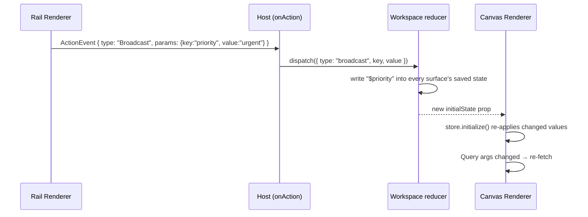

# Cross-surface control

!!! abstract "In one line"
    A click in one surface changes a `$variable` in other surfaces: the host writes the value into every surface's saved state, and each Renderer picks it up live.

**Adopt alone?** Needs [Persist & resume](persistence.md) (saved state passed as `initialState`) and [Custom actions](custom-actions.md) · **Effort** S · **Touches** client, prompt

## The problem

Each surface is its own `<Renderer>`, and each Renderer has its own state store. A button in the left rail can `@Set($priority, "urgent")`, but that only changes the rail's `$priority`. The canvas has a separate `$priority` and never hears about it.

You often want one surface to steer another: a menu in the rail filters the table in the canvas, an "Open" button in a table row shows that ticket in the dock.

## How the demo does it

A custom action, `@Broadcast(key, value)`, asks the host to set `$key` everywhere.



**1. The action is declared like any custom action** ([`client/src/openui/actions/broadcast.ts`](https://github.com/asafmor/openui-desk/blob/main/client/src/openui/actions/broadcast.ts)):

```ts
export const broadcast = defineAction({
  name: "Broadcast",
  description:
    'Set $key to value in EVERY surface (cross-surface control). E.g. @Broadcast("ticketId", t.id) makes the dock show that ticket.',
  params: z.object({
    key: z.string().describe('State name WITHOUT the $, e.g. "ticketId"'),
    value: z.union([z.string(), z.number(), z.boolean()]),
  }),
});
```

**2. The host handler forwards it** ([`client/src/actions/handlers/broadcast.ts`](https://github.com/asafmor/openui-desk/blob/main/client/src/actions/handlers/broadcast.ts)):

```ts
export const handleBroadcast: ActionHandler<"Broadcast"> = (event, { host }) => {
  host.broadcast(event.params.key, event.params.value);
};
```

**3. The reducer writes `$key` into every surface's saved state** ([`client/src/workspace/workspace-reducer.ts`](https://github.com/asafmor/openui-desk/blob/main/client/src/workspace/workspace-reducer.ts)):

```ts
function writeState(ws: Workspace, ids: readonly SurfaceId[], values: Record<string, unknown>): Workspace {
  let next = ws;
  for (const id of ids) next = withSurface(next, id, { state: { ...next.surfaces[id].state, ...values } });
  return next;
}
// …
case "broadcast":
  // `$` prefix = a reactive binding in Renderer state (initialState contract).
  return writeState(ws, SURFACE_IDS, { [`$${action.key}`]: action.value });
```

**4. Each surface passes its saved state back as `initialState`** ([`client/src/surfaces/SurfaceView.tsx`](https://github.com/asafmor/openui-desk/blob/main/client/src/surfaces/SurfaceView.tsx)). This is the part that makes it work without a remount. lang-core's store `initialize(defaults, persisted)` runs again when `initialState` changes, and it overwrites every value that differs. Then every expression and `Query` that reads `$priority` re-evaluates.

**5. The prompt names the shared keys** ([`shared/src/prompt/rules.ts`](https://github.com/asafmor/openui-desk/blob/main/shared/src/prompt/rules.ts)), so the agent uses the same names in every surface:

```ts
'CROSS-SURFACE CONTROL: a surface cannot @Set another surface\'s $variable. Use the custom action @Broadcast("key", value): it sets $key in EVERY surface. Use these shared keys consistently: $ticketId (selected ticket), $status, $priority (ticket filters, "all" = no filter), $days ("7" | "14" | "30"), $tab.',
"When a surface depends on a shared key (e.g. the dock shows $ticketId), declare it with a default ($ticketId = \"\") and pass it in Query args so it re-fetches when broadcast.",
```

In the Feature tour, the rail's "Saved views" menu broadcasts `status`, `priority` and `tab`, and each table row's "Open" button broadcasts `ticketId` to the dock.

## Port it to your app

1. **Keep each surface's state in your app**, not only inside the Renderer: store what `onStateUpdate` gives you and pass it back as `initialState`. (See [Persist & resume](persistence.md).)
2. **Declare the action** with `defineAction` (name, description, `params` Zod schema) and add it to your library's `actions`.
3. **Handle it in `onAction`**: when `event.type === "Broadcast"`, write `` `$${key}` `` into the stored state of every surface.
4. **Re-render with the new state.** Because your Renderers already receive `initialState` from that store, the change shows up live.
5. **Tell the model the shared keys** in `additionalRules`, and ask it to declare a default for each key it reads.

## Variations

- **Single surface.** You don't need this. `@Set` already works inside one Renderer.
- **Only some surfaces should listen.** Add a target to the action (`@Broadcast(key, value, "dock")`) or prefix keys per area. The demo keeps it simple: unused keys in a surface's state are harmless, because a program only reads the `$variables` it declares.
- **The agent should change state, not the user.** Use the agent tool from [Agent drives live state](agent-state.md). Its `surfaceId: "all"` does the same as `@Broadcast`, through the same reducer helper.
- **You already have your own chat/history.** Nothing changes; this concept is client-only.
- **No shared package.** Nothing changes; the rule text lives wherever you build the prompt.

## Pitfalls

!!! warning "The `$` prefix"
    The saved state uses `$`-prefixed keys for bindings (`"$priority"`), and form fields are stored under their form name. Write `$key`, not `key`, or the Renderer won't treat it as the binding.

- **Undeclared keys do nothing.** If the canvas program has no `$priority = "all"` line, broadcasting `priority` has no visible effect. That's why the rule asks for defaults.
- **Value types must match.** Broadcasting `"true"` into a boolean `$onlyBreached` makes a checkbox misbehave. Keep values typed (the action's `params` schema allows string, number and boolean).
- **`initialState` re-apply is the mechanism.** If your app remounts Renderers on every state change, it still works but loses scroll position and local component state. Pass new `initialState` to the same Renderer instead.

## Related

- [Persist & resume](persistence.md): where the saved state comes from.
- [Custom actions & the host](custom-actions.md): how custom actions reach the host.
- [Agent drives live state](agent-state.md): the agent-side equivalent.
- [Host-owned preferences](preferences.md): state that lives outside every Renderer.
