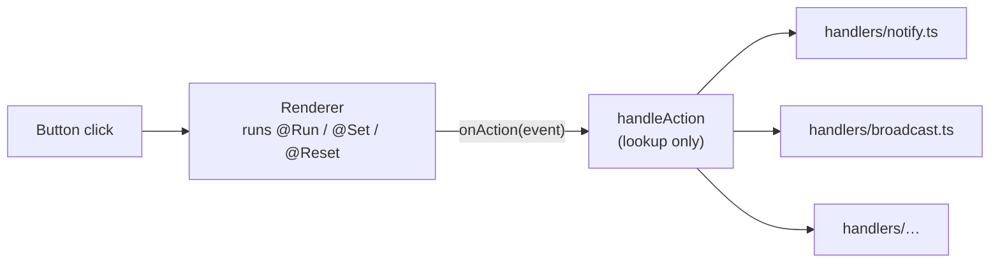

# Custom actions & the host

!!! abstract
    Let generated buttons ask **your app** to do things the Renderer can't, like show a toast, copy text, switch the theme or update another surface. Declare each action with `defineAction`, and handle it in one typed registry where a missing handler is a compile error.

**Adopt alone?** Yes · **Effort** S per action, M for the registry · **Touches** client, prompt (through the spec)

## The problem

Inside a program, buttons can run `@Run`, `@Set`, `@Reset`, `@ToAssistant` and `@OpenUrl`. Everything else lives outside the Renderer: toasts, the clipboard, app navigation, the theme, other surfaces. You want to give the model a few safe, named verbs for those, typed end to end, and you want adding the 30th verb to be as easy as adding the 3rd.

## How the demo does it

### 1. Declare the action

```ts title="client/src/openui/actions/notify.ts"
export const notify = defineAction({
  name: "Notify",
  description: "Show a short toast to the user.",
  params: z.object({
    message: z.string(),
    tone: z.enum(["info", "success", "warning", "danger"]).optional(),
  }),
});
```

[Source](https://github.com/asafmor/openui-desk/blob/main/client/src/openui/actions/notify.ts) · registered in `actions: customActions` of [`library.ts`](https://github.com/asafmor/openui-desk/blob/main/client/src/openui/library.ts)

The model uses it in any action prop:

```text
Button("Save", Action([@Run(updateTicket), @Run(tickets), @Notify("Saved " + $editId, "success")]))
```

The Renderer doesn't run custom actions. It emits an event, `{ type: "Notify", params: { message, tone } }`, to `<Renderer onAction>`. Because `@Run(mutation)` stops the chain when it fails, the toast shows only after a successful save.

### 2. Dispatch through a typed registry



The handler map's type is **derived from the library**, so each handler receives its own narrowed event:

```ts title="client/src/actions/handlers/types.ts"
export type AppActionEvent = LibraryActionEvent<AppLibrary>;
type AllHandlers = { [E in AppActionEvent as E["type"]]: (event: E, ctx: ActionContext) => void };
export type ActionHandlers = Omit<AllHandlers, "custom">;
export type ActionHandler<T extends keyof ActionHandlers> = ActionHandlers[T];
```

```ts title="client/src/actions/handlers/notify.ts"
export const handleNotify: ActionHandler<"Notify"> = (event) => {
  showToast(event.params.message, event.params.tone ?? "info");
};
```

```ts title="client/src/actions/handlers/index.ts"
export const ACTION_HANDLERS: ActionHandlers = {
  continue_conversation: handleContinueConversation, // built-in
  open_url: handleOpenUrl,                           // built-in
  CopyToClipboard: handleCopyToClipboard,
  Broadcast: handleBroadcast,
  Notify: handleNotify,
  ToggleTheme: handleToggleTheme,
};
```

The dispatcher only looks the handler up ([`handle-action.ts`](https://github.com/asafmor/openui-desk/blob/main/client/src/actions/handle-action.ts)). Each handler gets an `ActionContext`:

- `origin`: where the click happened (`"canvas"`, `"chat"`, `"artifact:…"`).
- `host`: app services built once in `App.tsx` (`sendActionTurn`, `broadcast`).

The compiler catches two kinds of mistake:

```text
Property 'ToggleTheme' is missing in type … but required in type 'ActionHandlers'.
Property 'msg' does not exist on type '{ message: string; tone?: "success" | … }'.
```

| Event type | Comes from | Demo handler does |
| --- | --- | --- |
| `continue_conversation` | `@ToAssistant(msg, ctx)` or a Button with no action | sends a chat turn with form state (see [Clicks that talk to the agent](action-turns.md)) |
| `open_url` | `@OpenUrl(url)` | `window.open(url, "_blank", "noopener,noreferrer")` |
| `CopyToClipboard` | custom | clipboard + toast |
| `Broadcast` | custom | sets `$key` in every surface (see [Cross-surface control](cross-surface.md)) |
| `Notify` | custom | toast |
| `ToggleTheme` | custom | flips `<html data-theme>` (see [Host-owned preferences](preferences.md)) |

`@Run`, `@Set` and `@Reset` run inside the Renderer and never reach `onAction`.

### Why a registry: the options considered

| Option | Verdict |
| --- | --- |
| **Typed registry, one file per handler** | ✅ Chosen. Adding an action is one file plus one line. The compiler catches missing handlers and wrong params. Easy to read top-down. |
| Handler next to its `defineAction` | ❌ `library.ts` is also loaded by the OpenUI CLI to generate the spec, so browser code (toasts, `document`, React) would leak into prompt generation. One behavior is forced on every host (surface, artifact panel, A2UI). |
| Event bus (`on("Notify", fn)`) | ❌ Wiring is invisible; nothing checks that every action is handled; duplicate or missing subscriptions fail silently. |

## Port it to your app

1. Declare an action: `defineAction({ name, description, params })`, and add it to `actions: [...]` in `createLibrary`.
2. Regenerate the spec so the prompt lists it.
3. Create the registry type from `LibraryActionEvent<typeof library>` (the three lines above) and an `ACTION_HANDLERS` object.
4. Write the handler in its own file, typed `ActionHandler<"YourAction">`, and add it to the registry.
5. Pass `onAction={(e) => handleAction(e, origin, host)}` to every `<Renderer>`.

## Variations

- **You already have your own chat and history.** Point the `continue_conversation` handler at your chat's send function. It's the only handler that touches the conversation.
- **No shared client/server package.** Nothing changes. Actions are client code, and the spec carries their signatures to the server.
- **Different behavior per host.** Pass a different `host` or `origin`, or give the artifact panel its own registry. The registry type keeps both complete.

### Generic vs specific actions

A generic `@SetLocalStorage(key, value)` looks reusable but was rejected. Writing a value doesn't apply it; programs can't read it back to toggle; any program could overwrite any key (including the autosave), and that's reachable by prompt injection; key/value strings lose prompt and validation help; and the name leaks the storage choice into saved programs. Use specific actions, or a typed `@SetPreference` whose keys come from a fixed list. See [Host-owned preferences](preferences.md).

## Pitfalls

!!! warning "Restricted action slots are not enforced"
    `z.union([copyToClipboard.ref, steps.OpenUrl.ref])` limits what the **prompt** offers for a prop, but in `@openuidev/react-lang` 1.0.1 any action is still accepted at runtime. Check sensitive actions in the handler.

- Validate params in handlers that touch anything sensitive. Programs are written by the model, which reads untrusted data such as ticket text.
- Action names are stored in saved programs. Name them for what they mean (`SetPreference`), not how they're implemented (`SetLocalStorage`).
- Don't put side effects in [custom functions](custom-functions.md). Functions run during evaluation, many times; actions run once per click.

## Related

- [Custom functions](custom-functions.md)
- [Cross-surface control](cross-surface.md)
- [Host-owned preferences](preferences.md)
- [Clicks that talk to the agent](action-turns.md)
- [Restricting components per surface](restricted-components.md)
- [Proposals (human in the loop)](proposals.md)
