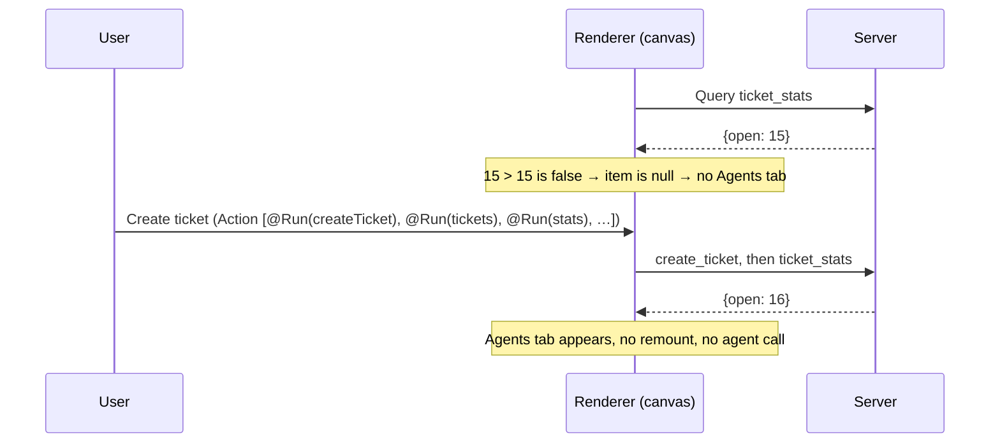

# Data-shaped UI

!!! abstract
    Let live server data decide which parts of a surface exist, not only what they show. In the demo, the canvas **Agents** tab exists only while more than 15 tickets are open.

**Adopt alone?** Yes (needs a `Query`; see [UI-side tools](ui-tools.md)) · **Effort** S · **Touches** program only

## The problem

Dashboards usually have a fixed layout and fill it with data. Some structure should follow the data instead:

- a warning banner only while something is wrong,
- a tab only when there is enough data to make it useful,
- an empty state instead of an empty table.

You don't want the agent to rewrite the program every time the data changes. The program should describe the rule once and keep applying it.

## How the demo does it

The canvas program puts a ternary **inside the tab list**:

```text
stats = Query("ticket_stats", {days: $days}, {open: 0, pending: 0, breached: 0, resolved: 0, byStatus: [], byPriority: [], daily: []})
tabs = Tabs([overviewTab, ticketsTab, stats.open > 15 ? agentsTab : null, labTab], $tab)
```

[Source](https://github.com/asafmor/openui-desk/blob/main/client/src/workspace/templates/feature-tour.ts)



Three details make it work:

1. **The component tolerates `null` children.** `Tabs` drops empty items before rendering:

    ```ts title="client/src/openui/components/layout/Tabs.tsx"
    const items = props.items.filter(Boolean);
    const active = items.find((t) => t.props.value === field.value) ?? items[0];
    ```

2. **Fallback without losing the choice.** If you are on the Agents tab when it disappears, the first tab shows instead. `$tab` keeps `"agents"`, so the tab is selected again when it comes back.
3. **Fresh data after writes.** The canvas `stats` Query has no refresh interval, so the Create and Save chains re-run it explicitly:

    ```text
    Action([@Run(createTicket), @Run(tickets), @Run(stats), @Reset(…), @Set($showCreate, false), …])
    ```

    To also pick up changes made elsewhere (other users, the server), give the Query a refresh interval as the 4th argument: `Query("ticket_stats", {…}, {…}, 30)`.

The seed data has exactly 15 open tickets, so the tab starts hidden. Create one ticket and it appears; resolve one and it goes away.

### The same idea elsewhere in the demo

```text
breachWarning = stats.breached > 0 ? Callout("danger", stats.breached + " active tickets breached their SLA", "…") : Callout("success", "All active tickets are within SLA")
detail = $ticketId == "" ? emptyView : ticketView
data.ticket.breached ? Badge("SLA breached", "danger") : null
Table([...], "No tickets match these filters.")   ← empty-state text as a prop
```

## Port it to your app

1. Load the deciding value with a `Query` and give it a safe default (`{open: 0}`). The default decides what shows while loading.
2. Put the condition where the child goes: `cond ? child : null`.
3. Make your container components skip `null` children (`.filter(Boolean)`), and pick a fallback when the selected child disappears.
4. Refresh the deciding Query after writes (`@Run(q)` in the action chain) or on an interval.
5. Optional: add a rule or example to your prompt so the agent writes this pattern itself ("hide sections that have no data; use `cond ? X : null`").

## Variations

- **Single surface.** Works the same; it's plain OpenUI Lang.
- **You already have your own chat and history.** No change. Nothing here involves the chat.
- **Your own components can't handle `null`.** Wrap the condition in a parent that always renders, for example `Stack([cond ? X : null])`, and make that parent filter `null`. Or fix the component once; it's one line.

## Pitfalls

- The default value decides the first frame. With `{open: 0}` the tab is hidden while loading; with a large default it would flash in and out.
- Conditions on data that never refreshes look broken. Pair them with `@Run(query)` after mutations or a refresh interval.
- Don't hide something the user is in the middle of using, such as an open form. Hide navigation entries instead, and keep the state (`$tab`) so it can come back.
- A hidden child is still part of the program, so the agent can still edit it. The agent sees the program but not which branch is visible, so describe such conditions in a prompt rule if hidden parts confuse it.

## Related

- [UI-side tools (Query / Mutation)](ui-tools.md)
- [Your own component library](component-library.md)
- [Custom functions](custom-functions.md)
- [Agent drives live state](agent-state.md)
