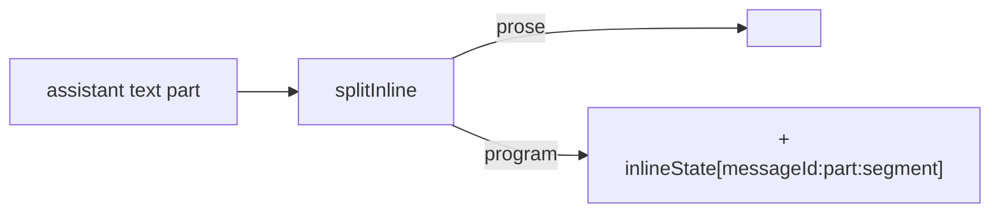

# Inline UI in chat

!!! abstract
    The agent can answer with prose plus a small fenced OpenUI Lang program. The chat shows the prose as text and renders each fenced block with its own `Renderer`. Its state is saved per message.

**Adopt alone?** Yes · **Effort** S · **Touches** client, prompt

## The problem

Some answers are best shown as UI — "the 3 oldest urgent tickets" as a table with Open buttons — but don't belong in a long-lived surface. You want throw-away UI inside the chat reply, next to the explanation.

## How the demo does it

### 1. The prompt: `inlineMode: true`

In [`shared/src/prompt/prompt-options.ts`](https://github.com/asafmor/openui-desk/blob/main/shared/src/prompt/prompt-options.ts):

```ts
inlineMode: true, // prose + fenced code, or prose only
```

The generated prompt gains an "Inline Mode" section: answer with prose, or wrap `openui-lang` code in triple-backtick fences with text before or after. A demo rule separates this from surfaces ([`shared/src/prompt/rules.ts`](https://github.com/asafmor/openui-desk/blob/main/shared/src/prompt/rules.ts)):

> A fenced openui-lang block in chat is a small, complete, throw-away program (with its own root) for an inline answer. Anything the user will keep using belongs in a surface.

### 2. Split prose from programs

The Renderer reads only what is inside fences, so the host renders the prose itself. [`client/src/chat/split-inline.ts`](https://github.com/asafmor/openui-desk/blob/main/client/src/chat/split-inline.ts) splits a possibly still streaming text:

```ts
export type Segment = { kind: "prose"; text: string } | { kind: "program"; text: string; complete: boolean };

const FENCE = /```(?:openui-lang|openui)?[^\n]*\n([\s\S]*?)(```|$)/g;

export function splitInline(text: string): Segment[] {
  // … push prose before each fence, then { kind: "program", text: match[1], complete: match[2] === "```" }
}
```

An unclosed fence at the end is a program that is still streaming (`complete: false`).

### 3. One Renderer per fenced block

[`client/src/chat/AssistantText.tsx`](https://github.com/asafmor/openui-desk/blob/main/client/src/chat/AssistantText.tsx) and [`InlineProgram.tsx`](https://github.com/asafmor/openui-desk/blob/main/client/src/chat/InlineProgram.tsx):

```tsx
{splitInline(text).map((seg, i) =>
  seg.kind === "prose"
    ? <p key={i} className="chat__prose">{seg.text.trim()}</p>
    : <InlineProgram key={i} stateKey={`${partKey}:${i}`} program={seg.text} streaming={streaming && !seg.complete} />,
)}

// InlineProgram
<Renderer
  response={program}
  library={library}
  isStreaming={streaming}
  initialState={state.workspace.inlineState[stateKey]}
  onStateUpdate={onStateUpdate}          // → dispatch({ type: "setInlineState", key: stateKey, state })
  onAction={onAction}                    // origin "chat"
  toolProvider={toolProvider}            // Queries work inline too
/>
```

`stateKey` is `messageId:partIndex:segmentIndex`. Inline state is stored in `workspace.inlineState`, so a form half-filled inside an old answer comes back after reload or import.



## Port it to your app

1. Set `inlineMode: true` in your `promptOptions` (full `generateSystemPrompt`, not `cloud: true`).
2. In your assistant message component, split the text on ```` ```openui-lang ```` fences.
3. Render prose as you already do (Markdown, etc.) and each program with a `<Renderer library={…} isStreaming={…}>`.
4. Optional: save each inline Renderer's state under a stable key (message id + index) with `initialState`/`onStateUpdate`.
5. Optional: add a rule telling the model when to use inline UI vs a surface.

## Variations

- **You already have your own chat/history.** You only change how assistant text is rendered. If you already render Markdown, treat ```` openui-lang ```` code blocks as a custom code-block renderer.
- **No surfaces at all.** Inline mode alone is the smallest useful OpenUI integration: every answer can carry UI.
- **No shared client/server package.** Nothing shared is needed; the prompt option lives on the server, the split on the client.

## Pitfalls

- **Markdown prose.** The demo renders prose as plain text, so it added a rule asking for no Markdown. If you render Markdown, drop that rule.
- **Stable keys.** If message ids change between sessions, saved inline state will not match.
- **Inline vs surface confusion.** Without a rule, the model may put a whole dashboard in chat. Say where long-lived UI goes.

## Related

- [Clicks that talk to the agent](action-turns.md)
- [Surface modeling](surfaces.md)
- [Artifacts](artifacts.md)
- [Prompt generation](prompt.md)
- [Persist & resume](persistence.md)
