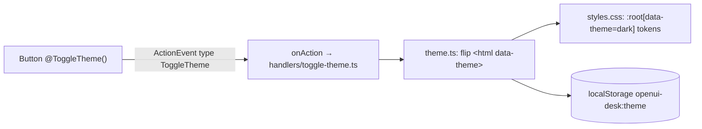

# Host-owned preferences

!!! abstract "In one line"
    Generated UI can ask the host to change app-wide settings, such as the theme, through a small typed custom action. The host owns the value, applies it and decides where it is stored.

**Adopt alone?** Needs [Custom actions & the host](custom-actions.md) · **Effort** S · **Touches** client (+ prompt via the generated spec)

## The problem

Some settings live outside every Renderer: the theme, density, language, the user's time zone. A surface's `$state` is private to that surface, so `@Set($theme, "dark")` changes nothing outside it. Only the host app can change `<html>`, the CSS or a user profile.

You still want a button in generated UI, or the agent, to be able to change them.

## How the demo does it

The Feature tour's rail has a "Toggle theme" button:

```
quick = Card([Stack([…, Button("Toggle theme", @ToggleTheme(), "ghost")])], "Quick actions")
```



**1. A custom action with no params** ([`client/src/openui/actions/toggle-theme.ts`](https://github.com/asafmor/openui-desk/blob/main/client/src/openui/actions/toggle-theme.ts)). The program only asks to flip; the host knows the current value.

```ts
export const toggleTheme = defineAction({
  name: "ToggleTheme",
  description: "Switch the whole app between light and dark theme.",
  params: z.object({}),
});
```

**2. The host handler calls a small theme module** ([`client/src/actions/handlers/toggle-theme.ts`](https://github.com/asafmor/openui-desk/blob/main/client/src/actions/handlers/toggle-theme.ts), [`client/src/actions/theme.ts`](https://github.com/asafmor/openui-desk/blob/main/client/src/actions/theme.ts)):

```ts
export const handleToggleTheme: ActionHandler<"ToggleTheme"> = () => toggleTheme();

// theme.ts
export function initTheme(): void {
  let saved: string | null = null;
  try {
    saved = localStorage.getItem(KEY);
  } catch {
    /* storage blocked: fall back to the OS preference */
  }
  const system: Theme = matchMedia("(prefers-color-scheme: dark)").matches ? "dark" : "light";
  apply(saved === "light" || saved === "dark" ? saved : system);
}

export function toggleTheme(): void {
  const next: Theme = document.documentElement.dataset.theme === "dark" ? "light" : "dark";
  apply(next);
  try {
    localStorage.setItem(KEY, next);
  } catch {
    /* not persisted; still applied for this session */
  }
}
```

**3. CSS keys the dark tokens on the attribute** ([`client/src/styles.css`](https://github.com/asafmor/openui-desk/blob/main/client/src/styles.css)): `:root` holds light tokens and `:root[data-theme="dark"]` the dark ones. Every component uses only CSS variables, so one attribute re-themes surfaces, charts and chat at once.

**4. `initTheme()` runs in `main.tsx` before the first render**, so dark mode doesn't flash light on load.

**Why it isn't in the workspace.** A theme is a per-viewer preference, not part of the work. It has its own localStorage key and is not exported with workspaces. If you want a workspace to carry its theme, store it in the workspace instead; that is a product choice, not a technical one.

## Port it to your app

1. **Decide where the value lives:** per browser (localStorage), per user (your profile API) or per workspace.
2. **Declare a custom action** with `defineAction`. Prefer intent (`ToggleTheme`, `SetPreference`) over storage (`SetLocalStorage`); see the analysis below.
3. **Regenerate your spec/prompt** so the model knows the action, and so your server-side validator accepts it.
4. **Handle it in `onAction`**: validate, apply (attribute, CSS class, context provider), then persist.
5. **Apply the saved value at startup**, before the first paint.

## Why not a generic `SetLocalStorage(key, value)`?

It looks more flexible, but it moves the work rather than removing it, and it opens a hole.

| Consequence | Why it matters |
|---|---|
| **Writing a value does nothing alone.** | Something still has to read `theme` and set `<html data-theme>`. Every option needs its own "apply" code anyway, so the agent can't add a working option by itself. |
| **Programs can't read it back.** | `@SetLocalStorage("theme", ???)` doesn't know the current value, so a toggle can't be written without a read function or extra state. |
| **Any program can write any key.** | Programs are model-written, and the model reads untrusted text (ticket titles from customers). A prompt injection could overwrite the workspace autosave, keys other code trusts (flags, API URLs, tokens), fill the ~5 MB quota so autosave fails, or touch other apps on the same origin. Restricted action slots are not enforced at runtime, so you can't rely on them. |
| **The model gets worse at using it.** | A typed action appears in the prompt with its allowed values, and the validator rejects mistakes. With free strings the model guesses `"darkMode"`, `"ui.theme"`, `"Dark"`, `true`, and nothing catches it. |
| **Action names become an API.** | Surfaces are saved and reloaded for months. `SetLocalStorage` names *where* the value is kept; if preferences move to a server profile, every saved program carries the wrong name. |
| **Storage is a product decision.** | localStorage means "this browser only, not exported, invisible to the agent". Fine for a theme, wrong for a setting that should travel with a workspace. |
| **Program-only settings already have a mechanism.** | If only programs read the value, `$state` plus [`@Broadcast`](cross-surface.md) already gives shared values saved with the workspace. |

Once you add an allowlist and value checks to make `SetLocalStorage` safe, you have built a typed preferences action.

!!! note "Recipe — not in the demo"
    The demo keeps `ToggleTheme` because it has one option. When a second option appears, replace it with a registry where each preference has a fixed set of values and an apply function:

    ```ts
    // preferences/registry.ts
    function pref<T extends string>(values: readonly [T, ...T[]], apply: (v: T) => void) {
      const schema = z.enum(values);
      return (raw: unknown): boolean => {
        const r = schema.safeParse(raw);
        if (r.success) apply(r.data as T);
        return r.success;
      };
    }

    export const PREFERENCES = {
      theme: pref(["light", "dark"], (v) => (document.documentElement.dataset.theme = v)),
      density: pref(["comfortable", "compact"], (v) => (document.documentElement.dataset.density = v)),
    };

    // openui/actions/set-preference.ts — keys listed literally so the CLI can load
    // the library without browser code
    export const setPreference = defineAction({
      name: "SetPreference",
      description: "Change a user preference. theme: light | dark. density: comfortable | compact.",
      params: z.object({ key: z.enum(["theme", "density"]), value: z.string() }),
    });

    // handler: the host is the trust boundary
    if (!PREFERENCES[key](value)) return console.warn(`Rejected preference ${key}=${value}`);
    localStorage.setItem(`app:pref:${key}`, value);
    ```

    For toggles, the host also writes each preference into every surface's `$state` (the same path as `@Broadcast`), so a program can write `@SetPreference("theme", $theme == "dark" ? "light" : "dark")` after declaring `$theme = "light"`.

## Variations

- **You already have your own chat/history.** Nothing changes; this is client-only.
- **No shared package.** Nothing changes. The action lives in the client library; the server learns it through the generated spec.
- **Per-user settings on the server.** Keep the action and handler; replace the localStorage write with a call to your profile API, and load the value at startup.

## Pitfalls

- **Library code is also loaded by the OpenUI CLI** (`openui generate`). Keep browser-only code (`document`, toasts) in host handlers, not next to `defineAction`.
- **Wrap every `localStorage` access in `try/catch`.** It throws in private mode, with blocked storage or when the quota is full.
- **The button label can't show the current theme** unless the host writes it into `$state`. `ToggleTheme` avoids the problem by having no params.

## Related

- [Custom actions & the host](custom-actions.md)
- [Cross-surface control](cross-surface.md)
- [Persist & resume](persistence.md): what is and isn't saved with a workspace.
