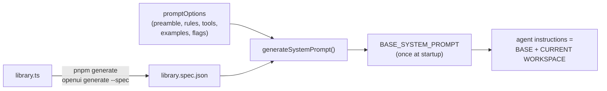

# Prompt generation

!!! abstract
    Don't hand-write the system prompt that teaches OpenUI Lang. Generate it from your library's spec with `generateSystemPrompt({ library, promptOptions })`, and add only your domain rules, tools and examples.

**Adopt alone?** Yes (needs a component library; see [Your own component library](component-library.md)) · **Effort** S · **Touches** server, prompt

## The problem

The model must know the language syntax, every component's signature, the built-in functions, how `Query`/`Mutation` work, how to patch a program and how to mix prose with UI. That's thousands of words, and it has to stay in sync with your components. Hand-written prompts drift. A generated prompt changes when the library changes.

## How the demo does it



**1. Spec.** `pnpm generate` runs the OpenUI CLI on the library file:

```bash
openui generate src/openui/library.ts --spec --out ../shared/generated/library.spec.json
```

**2. Prompt, built once at server startup:**

```ts title="server/src/mastra/prompt/system-prompt.ts"
import { librarySpec } from "@demo/shared/library-spec";
import { promptOptions } from "@demo/shared/prompt/prompt-options";
import { generateSystemPrompt } from "@openuidev/lang-core";

export const BASE_SYSTEM_PROMPT = generateSystemPrompt({ library: librarySpec, promptOptions });
```

[Source](https://github.com/asafmor/openui-desk/blob/main/server/src/mastra/prompt/system-prompt.ts)

**3. Options**, kept in a React-free shared module:

```ts title="shared/src/prompt/prompt-options.ts"
export const promptOptions: PromptOptions = {
  preamble: PREAMBLE,              // who the assistant is, what surfaces are
  additionalRules: RULES,          // domain + app rules (surfaces, tools, chat style)
  tools: ALL_UI_TOOLS.map(toToolSpec), // UI-side tools for Query()/Mutation()
  toolExamples: TOOL_EXAMPLES,     // validated example programs
  toolCalls: true,                 // teaches Query(), Mutation(), @Run
  bindings: true,                  // teaches $variables, @Set, @Reset, $binding<type>
  editMode: true,                  // answer with changed statements only (patches)
  inlineMode: true,                // prose + fenced UI in chat
};
```

[Source](https://github.com/asafmor/openui-desk/blob/main/shared/src/prompt/prompt-options.ts)

| Option | What it adds | Demo file |
| --- | --- | --- |
| `preamble` | Text at the very top | [`preamble.ts`](https://github.com/asafmor/openui-desk/blob/main/shared/src/prompt/preamble.ts) |
| `additionalRules` | Your rules, after the generated sections | [`rules.ts`](https://github.com/asafmor/openui-desk/blob/main/shared/src/prompt/rules.ts) |
| `tools` | Tool names, or `ToolSpec`s with input/output JSON Schema and read-only/destructive hints | [`descriptors.ts`](https://github.com/asafmor/openui-desk/blob/main/shared/src/ui-tools/descriptors.ts) |
| `examples` / `toolExamples` | Whole example programs | [`examples.ts`](https://github.com/asafmor/openui-desk/blob/main/shared/src/prompt/examples.ts) |
| `toolCalls`, `bindings`, `builtinFunctions` | Language sections. They default on once `tools` is set; the demo writes them out for clarity. | — |
| `editMode`, `inlineMode` | Patch-style answers; prose with optional fenced UI | — |

**Tool descriptors from Zod contracts.** Each UI tool has one Zod contract. `toToolSpec` turns it into the `ToolSpec` the prompt prints, with `z.toJSONSchema` and annotations that tell the model whether to use it in a `Query` or a `Mutation`:

```ts title="shared/src/ui-tools/descriptors.ts"
export function toToolSpec(contract: UiToolContract): ToolSpec {
  return {
    name: contract.name,
    description: `[${contract.kind === "query" ? "Query" : "Mutation"}] ${contract.description}`,
    inputSchema: z.toJSONSchema(contract.input) as Record<string, unknown>,
    outputSchema: z.toJSONSchema(contract.output) as Record<string, unknown>,
    annotations: { readOnlyHint: contract.kind === "query", destructiveHint: contract.kind === "mutation" },
  };
}
```

**Examples are tested.** A wrong example teaches a wrong pattern. `pnpm check` ([`scripts/check-programs.ts`](https://github.com/asafmor/openui-desk/blob/main/scripts/check-programs.ts)) parses every example and template against the spec before the dev server starts.

**Read what the model reads.** `pnpm prompt` ([`scripts/print-prompt.ts`](https://github.com/asafmor/openui-desk/blob/main/scripts/print-prompt.ts)) prints the full prompt, including the live-workspace section the agent gets per request.

## Port it to your app

1. Generate the spec from your library with the CLI (`--spec --out <path>`). Do it in your build so it can't go stale.
2. On the server: `generateSystemPrompt({ library: spec, promptOptions })`. Start with `{ preamble, additionalRules }` and add flags as you adopt features: `tools` for [UI-side tools](ui-tools.md), `editMode` for [agent edits](agent-edits.md), `inlineMode` for [inline UI](inline-ui.md).
3. Build it once at startup, and append per-request context in your Mastra agent's `instructions` function. See [Live UI context for the agent](workspace-context.md).
4. Add 1–3 example programs from your domain and parse them in CI.
5. Print the final prompt once and read it.

## Variations

- **You already have your own chat and history.** Only the agent's `instructions` change. Chat storage is unaffected.
- **No shared client/server package.** The server needs only the spec JSON and the prompt options. Keep the options on the server, or in a small published package, and copy the spec from the client build. See [No shared client/server package](../porting/no-shared-package.md).
- **Several libraries or agents.** Generate one prompt per spec. See [Restricting components per surface](restricted-components.md).

## Pitfalls

!!! danger "`cloud: true` drops most options"
    `generateSystemPrompt({ cloud: true, … })` targets OpenUI Cloud and keeps only `preamble`, `examples` and `additionalRules` (`CloudPromptOptions`). `tools`, `toolCalls`, `bindings`, `editMode` and `inlineMode` are dropped **silently**, so Query, Mutation, `$state` and patches disappear from the prompt. For a self-hosted Mastra agent, use the full prompt (no `cloud`).

- The built-in sections use OpenUI's reference component names (`Form`, `FormControl`, `Input`, `Select`, `SelectItem`, `Button`, `TextContent`, `Stack`). Keep those names in your library, or expect `unknown-component` errors.
- Rules compete with the generated text. Keep each rule short and specific to your domain ("use `$status` with `\"all\"` for no filter"), and prefer an example over a paragraph.
- A stale spec means the prompt describes components the browser doesn't have, or the reverse. Regenerate it on every library change.
- `generatePrompt(spec)` and the single-argument `generateSystemPrompt(spec)` are deprecated; pass `{ library, promptOptions }`.

## Related

- [Your own component library](component-library.md)
- [UI-side tools (Query / Mutation)](ui-tools.md)
- [Live UI context for the agent](workspace-context.md)
- [Agent edits surfaces](agent-edits.md)
- [Restricting components per surface](restricted-components.md)
