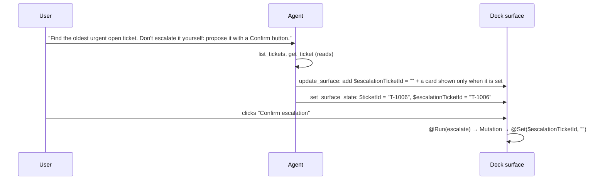

# Proposals (human in the loop)

!!! abstract
    The agent cannot press buttons. For writes, it builds a confirmation card and fills it in; the user clicks the button that runs the Mutation. This needs no new code if you already have [Agent edits surfaces](agent-edits.md) and [Agent drives live state](agent-state.md).

**Adopt alone?** Needs: [Agent edits surfaces](agent-edits.md) and [Agent drives live state](agent-state.md) · **Effort** S (prompt rule + example) · **Touches** prompt

## The problem

The user says *"escalate the oldest urgent ticket"*. You want the agent to help, but writes should stay under the user's control, and a prompt injection hidden in ticket text must not be able to trigger them.

## Why the agent can't "click"

OpenUI Lang has no effects. Expressions only compute values; actions (`@Run`, `@Set`, `@Reset`, `@ToAssistant`, `@OpenUrl`, custom actions) run only when the user interacts with a component. A ternary can show or hide a button, but cannot press it.

| What the agent changes | Can it cause… | How |
| --- | --- | --- |
| A `$variable` | Anything a `@Set` does: tab, filter, open modal, prefill inputs | [`set_surface_state`](agent-state.md) |
| A `$variable` used in Query args | A Query re-fetch (reads) | Query results are cached by tool + args; new args → new fetch |
| — | A Mutation (write) | ❌ Only `@Run(mutation)` inside a clicked action |
| — | `@Notify`, `@ToAssistant`, custom actions | ❌ Only from a click |

!!! warning "Don't use a Query for a side effect"
    `Query("escalate_ticket", {id: $escalateId})` would run when the agent sets `$escalateId`. Queries are meant to be safe to repeat, and lang-core re-runs them on mount, page reload, workspace import, refresh intervals and Retry. Each of those would escalate again.

## How the demo does it

The demo has no special code for this. With both tools available, a request that asks for a confirmation card produces one:



The patch the agent wrote in one run (trimmed):

```
$escalationTicketId = ""
escalate = Mutation("escalate_ticket", {id: $escalationTicketId, reason: "…Escalation confirmed by user from the dock."})
escalationConfirmation = $escalationTicketId != "" && $ticketId == $escalationTicketId ? Card([Callout("warning", "Proposed escalation · " + $escalationTicketId, …), Buttons([Button("Confirm escalation", Action([@Run(escalate), @Run(data), @Run(feed), @Set($escalationTicketId, ""), @Notify("Escalation confirmed", "success")]), "danger"), Button("Cancel", @Set($escalationTicketId, ""), "secondary")])]) : null
```

Observed with the real model: the card appeared after 22–34 s (two runs), clicking it logged **one** escalation, and the card disappeared because the action clears `$escalationTicketId`. Both tool calls ran in the same turn: the second passed validation because `update_surface` had already recorded the new program in the request's context.

!!! note "Observed behaviour"
    - The agent invented the pattern from the wording of the request. Nothing in the demo's prompt teaches it, so a vague "escalate T-1006" may get a refusal (the rules say the agent cannot write data).
    - In one run the agent also removed the dock's existing "Escalate" button without being asked. ↶ Undo restores it.

## Port it to your app

1. Have [Agent edits surfaces](agent-edits.md) and [Agent drives live state](agent-state.md) in place.
2. Add a rule and one validated example to your prompt, e.g.: *"You cannot write data. When asked to change data, add a confirmation card with a `$proposal` variable and a Button that runs the Mutation, then set `$proposal` with set_surface_state."*
3. Keep Mutation arguments bound to the `$proposal` variables, not hard-coded, so one card can be reused for the next proposal.
4. End the confirm action with `@Set($proposal, "")` so the card closes after use.

## Variations

- **Single surface.** Put the card in the one surface; nothing else changes.
- **You already have your own chat/history.** Nothing changes; this is a prompt and program pattern.
- **The agent writes data itself.** Expose the Mutation as an agent tool instead (the demo's contracts have an `agentSide` flag for reads) and ask for approval on the server. No button involved.
- **Refresh without new args.** To re-run a Query when nothing in its args changed, give it a dummy argument:

!!! note "Recipe — not in the demo"
    ```
    $refresh = 0
    tickets = Query("list_tickets", {status: $status, v: $refresh}, {rows: []})
    ```
    The agent sets `$refresh` to a new number with `set_surface_state`; the new cache key triggers a fetch. The tool must accept the extra `v` argument. The demo's REST tools validate input with a Zod object, which strips unknown keys; a strict schema (for example `additionalProperties: false` on an MCP tool) would reject it, so add an optional `v` to the contract there.

!!! note "Recipe — not in the demo: a `press_button` tool"
    Possible only because you own your components:

    1. Each `Button` registers its action runner (the function from `useTriggerAction`) with the host, keyed by surface and label, while it is mounted.
    2. A `press_button({surfaceId, label, row?})` tool result makes the host call that runner, which runs the action exactly like a click (form validation, `@Run`, `@Set`, `@Notify`).

    Costs: only mounted buttons exist (a button inside a closed modal or another tab needs `set_surface_state` first); rows repeat labels like "Edit", so you need a row key; and it needs an Allow/Deny step, or text inside a ticket could make the agent press "Escalate". The proposal card gives the same result with no new code.

## Pitfalls

- **Hidden writes.** Never hide a Mutation behind a Query or an auto-run trick.
- **Stale proposals.** Bind the card's visibility to the proposal variable and clear it in both Confirm and Cancel.
- **Prompt coverage.** Without a rule and example, the model may refuse or improvise.

## Related

- [Agent drives live state](agent-state.md)
- [Agent edits surfaces](agent-edits.md)
- [UI-side tools (Query / Mutation)](ui-tools.md)
- [Custom actions & the host](custom-actions.md)
- [Prompt generation](prompt.md)
