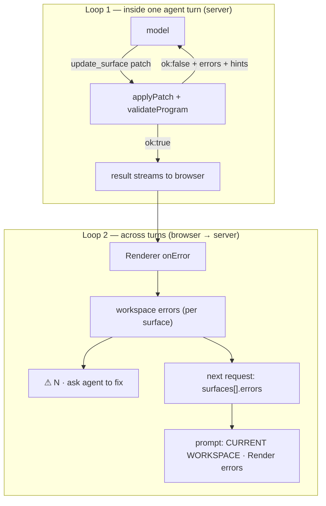

# Fixing errors with the agent

!!! abstract "In one line"
    Catch broken programs twice: on the server, before a patch is accepted, so the agent fixes it in the same turn; and in the browser, at render time, so the errors are sent with the next request and the user can ask the agent to fix them.

**Adopt alone?** Loop 1 needs a server tool that receives programs ([Agent edits surfaces](agent-edits.md)). Loop 2 needs [Live UI context for the agent](workspace-context.md) · **Effort** M · **Touches** client, server, prompt

## The problem

Models write invalid OpenUI Lang sometimes: an unknown component, a wrong argument type, a reference to a statement that doesn't exist, a statement nothing renders. Other errors only appear at runtime: a custom function throws, a Query's tool fails.

Without a feedback loop, the user sees a half-rendered surface and has to explain the problem in words.

## How the demo does it



### Loop 1: validate before accepting

`validateProgram` builds the same parser the Renderer uses, from the generated library spec, and turns its result into a list of issues ([`shared/src/program/validate-program.ts`](https://github.com/asafmor/openui-desk/blob/main/shared/src/program/validate-program.ts)):

```ts
const parser = createParser(
  (librarySpec as unknown as { schema: LibraryJSONSchema }).schema,
  librarySpec.root,
);

export function validateProgram(program: string): ProgramIssue[] {
  const result = parser.parse(program);
  const issues: ProgramIssue[] = result.meta.errors
    .filter((e) => e.severity !== "warning")
    .map((e) => ({ code: e.code, statementId: e.statementId, message: e.message }));
  if (!result.root) issues.push({ code: "no-root", message: "The program has no root statement." });
  if (result.meta.incomplete) issues.push({ code: "incomplete", message: "Unclosed string or bracket." });
  for (const name of result.meta.unresolved)
    issues.push({ code: "unresolved", statementId: name, message: `"${name}" is referenced but never defined.` });
  for (const name of result.meta.orphaned)
    issues.push({ code: "orphaned", statementId: name, /* … */ hint: `Reference ${name} from a parent, or delete it with ${name} = null.` });
  return issues;
}
```

The `update_surface` tool merges the patch, validates the result and returns the issues instead of applying anything ([`server/src/mastra/tools/update-surface.ts`](https://github.com/asafmor/openui-desk/blob/main/server/src/mastra/tools/update-surface.ts)):

```ts
const merged = applyPatch(current, patch);
const errors = validateProgram(merged);
if (errors.length > 0) {
  return { ok: false, surfaceId, errors, note: "Nothing was applied. Fix the errors and call update_surface again." };
}
```

A prompt rule tells the model what to do with that ([`shared/src/prompt/rules.ts`](https://github.com/asafmor/openui-desk/blob/main/shared/src/prompt/rules.ts)): *"If update_surface returns ok:false, read its errors (each has a hint) and call update_surface again with a corrected patch. Do not tell the user it worked until ok:true."* The chat shows the failed attempt in red, then the fixed one. `set_surface_state` and `publish_artifact` follow the same pattern.

!!! tip "Judge only finished programs"
    While a program streams, `incomplete` and `unresolved` are normal. Validate after the tool input is complete, never mid-stream.

### Loop 2: report runtime errors back

`<Renderer onError>` receives structured errors from the parser, the runtime (bad expression, a custom function or component that throws) and the query system (tool not found, tool error). It is called with `[]` once everything is fixed. The demo keeps them per surface ([`client/src/surfaces/useErrorReporter.ts`](https://github.com/asafmor/openui-desk/blob/main/client/src/surfaces/useErrorReporter.ts)):

```ts
(errors: OpenUIError[]) => {
  const trimmed: SurfaceError[] = errors
    .filter((e) => e.severity !== "warning")
    .map((e) => ({ code: e.code, statementId: e.statementId, message: e.message, hint: e.hint }));
  const key = JSON.stringify(trimmed);
  if (key === last.current) return; // avoid re-dispatching identical lists
  last.current = key;
  dispatch({ type: "setSurfaceErrors", surfaceId, errors: trimmed });
}
```

Those errors then travel two ways:

- **Automatically** with every chat request, in `requestContext.surfaces[].errors`. The server prints them under each surface as `Render errors: …` ([`server/src/mastra/prompt/surface-context.ts`](https://github.com/asafmor/openui-desk/blob/main/server/src/mastra/prompt/surface-context.ts)), and a rule says to fix listed errors the next time the agent touches that surface.
- **On request**: the surface header shows a "⚠ N · ask agent to fix" button that sends a chat turn with the errors as context ([`client/src/surfaces/SurfaceFrame.tsx`](https://github.com/asafmor/openui-desk/blob/main/client/src/surfaces/SurfaceFrame.tsx)).

Errors are runtime-only: they are not saved with the workspace, because they are recomputed when the surface renders again.

### Keep the rest of the screen alive

- **Query errors** use the Renderer's slot API: `<Renderer.Content>` stays mounted, and `<Renderer.QueryError>` shows a banner with `<Renderer.Retry>` ([`client/src/surfaces/SurfaceView.tsx`](https://github.com/asafmor/openui-desk/blob/main/client/src/surfaces/SurfaceView.tsx)).
- **Crashes outside a Renderer** are caught per panel by a small React error boundary, so one broken surface doesn't take down the chat or stop autosave ([`client/src/layout/PanelBoundary.tsx`](https://github.com/asafmor/openui-desk/blob/main/client/src/layout/PanelBoundary.tsx)).

## Port it to your app

1. **Generate a spec** of your library (`openui generate <library file> --spec --out <file>.json`) so the server can parse programs without React.
2. **Validate on the server** with `createParser(spec.schema, spec.root)` from `@openuidev/lang-core`. Report `meta.errors` (skip warnings), a missing root, `meta.incomplete`, `meta.unresolved` and `meta.orphaned`.
3. **Return errors from the tool instead of throwing.** A thrown error ends the step; a returned `{ ok: false, errors }` is something the model can read and act on in the same turn.
4. **Add one prompt rule** telling the model to retry on `ok:false` and not to claim success.
5. **Collect `onError`** per surface in the browser, drop warnings, and send the list with the next request.
6. **Show the errors in the prompt** next to the program they belong to, and offer the user a one-click "ask the agent to fix".

## Variations

- **No shared client/server package.** Loop 1 only needs the spec JSON and `@openuidev/lang-core` on the server; copy or generate the spec into the server build. Loop 2's error shape is a few fields (`code`, `statementId`, `message`, `hint`) you can define twice. See [No shared package](../porting/no-shared-package.md).
- **You already have your own chat/history.** Loop 1 is unchanged (it's inside the tool). For Loop 2 you need a way to attach the current errors to each request; see [You already have chat & history](../porting/own-chat.md).
- **Programs arrive in chat text, not through a tool.** You can't run Loop 1 inside the turn. Validate when the message finishes and send the errors back as the next user turn, or rely on Loop 2 only.
- **Single surface.** Same steps, one error list.

## Pitfalls

- **Keep the parser in sync with the browser.** If the spec is stale (you added a component and didn't regenerate), the server rejects programs the browser would render. The demo regenerates the spec as the first step of `pnpm dev`.
- **Don't send warnings.** They still render; sending them wastes tokens and can make the model "fix" things that work.
- **Deduplicate `onError` calls.** It fires on every re-evaluation; dispatching identical lists causes needless re-renders and autosaves.
- **Orphans are errors here on purpose.** A statement nothing references won't render; telling the model saves a confused follow-up turn.

## Related

- [Agent edits surfaces](agent-edits.md): the tool that runs Loop 1.
- [Live UI context for the agent](workspace-context.md): how errors reach the prompt.
- [Runtime diagnostics](diagnostics.md): seeing the same errors yourself.
- [Prompt generation](prompt.md): where the rules live.
