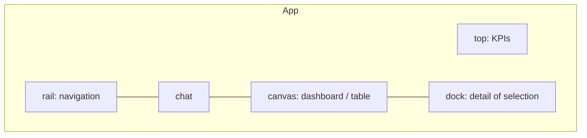

# Surface modeling

> A **surface** is a region of your app that holds one OpenUI program and outlives chat
> turns. Decide how many you need, where they sit, and how the agent targets them.

**Adopt alone?** Yes · **Effort** S · **Touches** client (plus a prompt line per surface)

## The problem

The default OpenUI setup renders UI inside assistant messages. That UI scrolls away and
is regenerated on every question. Dashboards, tables and forms that people use for hours
need a fixed home that:

- stays mounted while the conversation continues,
- keeps its own state (filters, tabs, inputs),
- can be changed by the agent without being replaced.

## How the demo does it

Four fixed surfaces surround the chat. The list and the purpose of each one live in one
file, which both the client layout and the agent's prompt read.

```ts
export const SURFACE_IDS = ["top", "rail", "canvas", "dock"] as const;
export type SurfaceId = (typeof SURFACE_IDS)[number];

export const SURFACES: Record<SurfaceId, { title: string; purpose: string }> = {
  top: {
    title: "Top strip",
    purpose: "A thin horizontal strip across the top: 3-6 compact KPIs … in ONE row …",
  },
  // rail, canvas, dock …
};
```

[shared/src/surfaces.ts](https://github.com/asafmor/openui-desk/blob/main/shared/src/surfaces.ts)

Each surface is rendered by its own long-lived `<Renderer>`:

```tsx
<Renderer.Root
  response={response}          // the surface's program
  library={library}
  isStreaming={firstStream}
  initialState={surface.state} // saved $state + form values
  onStateUpdate={onStateUpdate}
  onAction={onAction}
  onError={onError}
  toolProvider={toolProvider}
>
  <Renderer.Content className="surface__content" />
  {/* QueryError + Retry slots … */}
</Renderer.Root>
```

[client/src/surfaces/SurfaceView.tsx](https://github.com/asafmor/openui-desk/blob/main/client/src/surfaces/SurfaceView.tsx)

Key properties of this design:

| Property | How |
| --- | --- |
| **Independent programs** | each surface has its own `program`, `state` and `history` in the workspace |
| **Independent state** | each `<Renderer>` has its own `$variable` store; names do not leak between surfaces |
| **Agent targets one surface per call** | `update_surface({ surfaceId, patch })` takes a `z.enum(SURFACE_IDS)` |
| **Purpose in the prompt** | the CURRENT WORKSPACE section prints each surface's title and purpose |
| **Remount on load** | every `SurfaceView` is keyed by the workspace id, so loading a workspace remounts all Renderers |



## Port it to your app

1. **List your surfaces** in one module with an id, a title and a one-line purpose. The
   purpose shapes what the agent builds there ("one row of KPIs", "narrow column").
2. **Store one record per surface**: `{ program: string; state: Record<string, unknown> }`.
   An empty `program` means "not built yet".
3. **Mount one `<Renderer>` per surface** in a fixed layout slot, with `response={program}`,
   `initialState={state}` and `onStateUpdate` writing back to the record.
4. **Show the surfaces to the agent** (ids, purposes, programs). See
   [Live UI context](workspace-context.md).
5. **Let the agent target a surface by id**, e.g. a tool input
   `surfaceId: z.enum(SURFACE_IDS)`. See [Agent edits surfaces](agent-edits.md).

## Variations

=== "Single surface"

    Most apps need one: "the dashboard" next to the chat. Keep the same record shape
    with a single entry and drop `surfaceId` from tool inputs. You lose nothing. Add a
    second surface later without changing the stored format, because a workspace is a
    map of id → record.

=== "Dynamic surfaces"

    If users create surfaces (tabs, pinned panels), store `surfaces` as an ordered list of
    `{ id, title, purpose, program, state }` and let the agent's tool accept any existing
    id. Validate the id on the server against what the browser sent, because the model
    may invent one.

=== "Own chat & history"

    Surfaces do not depend on how chat is stored. They only need a place to live (your
    page) and a record to persist. See [You already have chat & history](../porting/own-chat.md).

=== "No shared package"

    Keep the surface list on the server (it builds the prompt and validates ids) and send
    the ids the client renders with each request. See
    [No shared client/server package](../porting/no-shared-package.md).

!!! note "Recipe — not in the demo: surfaces inside chat messages"
    A surface does not have to be a fixed slot. A "pinned" inline UI is a surface whose
    slot is a chat message: give it an id, store its program and state in the workspace
    instead of the message, and render it where the message is.

## Pitfalls

- **One program per surface.** `$variables` and statement names are per Renderer. A
  rail button cannot `@Set` the canvas' `$priority`; use
  [Cross-surface control](cross-surface.md).
- **Purpose text matters.** Without "one row, compact" the agent puts tables in the top
  strip. Treat the purpose as part of the prompt.
- **Remount deliberately.** Keying Renderers by workspace id gives a clean mount on load.
  Keying them by program would remount on every patch and lose in-flight state.
- **Crash isolation.** Wrap each surface in an error boundary so one bad component does
  not take the app (and its autosave) down. The demo uses `PanelBoundary`.

## Related

- [Persist & resume](persistence.md)
- [Live UI context for the agent](workspace-context.md)
- [Agent edits surfaces](agent-edits.md)
- [Cross-surface control](cross-surface.md)
- [Restricting components per surface](restricted-components.md)
