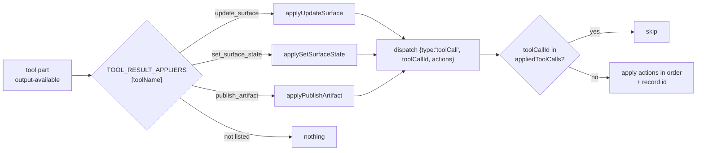

# Applying tool results

!!! abstract
    Agent tools that change the UI return a result; the browser turns each finished result into state changes. A registry of small pure "appliers" plus one "apply once per tool call" check keeps this simple as tools grow.

**Adopt alone?** Yes (it is the client half of [Agent edits surfaces](agent-edits.md), [Agent drives live state](agent-state.md) and [Artifacts](artifacts.md)) · **Effort** S · **Touches** client

## The problem

With the AI SDK UIMessage protocol, tool calls arrive as message **parts**. Your client re-runs over the message list many times: on every streamed chunk, after a reload, after importing a saved conversation. If applying a result is not idempotent, an old "set priority to urgent" overwrites the filter the user changed later, or an artifact gets a duplicate version.

And with dozens of tools, one big loop with a branch per tool becomes hard to read.

## How the demo does it

### Tool parts and their states

A server tool appears in `UIMessage.parts` as `tool-<name>` (or `dynamic-tool`). `isToolUIPart` and `getToolName` from `ai` read both shapes ([`client/src/chat/tool-parts.ts`](https://github.com/asafmor/openui-desk/blob/main/client/src/chat/tool-parts.ts)):

| `part.state` | Meaning |
| --- | --- |
| `input-streaming` | `part.input` is a partial object parsed from partial JSON |
| `input-available` | Full input; the tool is running on the server |
| `output-available` | `part.output` holds the tool's return value |
| `output-error` | `part.errorText` |

Only `output-available` changes the workspace.



### 1. Pure appliers, one file per tool

An applier maps a tool output to workspace actions. No dispatch, no React, no bookkeeping ([`client/src/chat/tool-results/types.ts`](https://github.com/asafmor/openui-desk/blob/main/client/src/chat/tool-results/types.ts), [`update-surface.ts`](https://github.com/asafmor/openui-desk/blob/main/client/src/chat/tool-results/update-surface.ts)):

```ts
export type ToolResultApplier = (output: unknown) => BaseWorkspaceAction[];

export const applyUpdateSurface: ToolResultApplier = (output) => {
  const out = output as UpdateSurfaceOutput | undefined;
  if (!out?.ok || !isSurfaceId(out.surfaceId) || !out.patch) return [];
  return [{ type: "applyPatch", surfaceId: out.surfaceId, patch: out.patch, summary: out.summary ?? "agent edit" }];
};
```

Returning an array lets one tool make several changes in a single step. Returning `[]` ignores the result (for example `ok:false`: the agent retries in the same turn).

### 2. A registry keyed by tool name

[`client/src/chat/tool-results/index.ts`](https://github.com/asafmor/openui-desk/blob/main/client/src/chat/tool-results/index.ts):

```ts
export const TOOL_RESULT_APPLIERS: Record<string, ToolResultApplier> = {
  update_surface: applyUpdateSurface,
  set_surface_state: applySetSurfaceState,
  publish_artifact: applyPublishArtifact,
};
```

Read-only tools (`list_tickets`, …) are not listed; they still show as cards in the chat.

### 3. A generic router

[`client/src/chat/apply-tool-results.ts`](https://github.com/asafmor/openui-desk/blob/main/client/src/chat/apply-tool-results.ts):

```ts
for (const message of messages) {
  if (message.role !== "assistant") continue;
  for (const part of toolParts(message)) {
    if (part.state !== "output-available") continue;
    const apply = TOOL_RESULT_APPLIERS[getToolName(part)];
    const actions = apply?.(part.output) ?? [];
    if (actions.length > 0) dispatch({ type: "toolCall", toolCallId: part.toolCallId, actions });
  }
}
```

### 4. One idempotency envelope in the reducer

[`client/src/workspace/workspace-reducer.ts`](https://github.com/asafmor/openui-desk/blob/main/client/src/workspace/workspace-reducer.ts):

```ts
case "toolCall": {
  if (ws.appliedToolCalls.includes(action.toolCallId)) return ws; // already applied (e.g. after import)
  const next = action.actions.reduce(reduceWorkspace, ws);
  return { ...next, appliedToolCalls: [...next.appliedToolCalls, action.toolCallId] };
}
```

`appliedToolCalls` is saved with the workspace, so reloading or importing a conversation never re-applies a result.

### 5. A runnable check

[`scripts/check-tool-results.ts`](https://github.com/asafmor/openui-desk/blob/main/scripts/check-tool-results.ts) runs in `pnpm check` without a browser. It asserts that a repeated `toolCallId` changes nothing, actions apply in order, `ok:false` applies nothing, and artifact versions count up.

## Port it to your app

1. Write one applier per UI-changing tool: `(output: unknown) => YourStoreAction[]`. Check the output shape before trusting it.
2. Put them in a `Record<toolName, applier>`.
3. Where you watch messages, loop over tool parts with `isToolUIPart`/`getToolName`, only for `output-available`, and dispatch the actions wrapped with the `toolCallId`.
4. In your store, skip a `toolCallId` you have already applied, and persist that list with the rest of your UI state.

## Variations

- **You already have your own chat/history (e.g. Mastra Memory threads).** The history may come back from the server instead of from `useChat`. The same loop works on any `UIMessage[]`. If your UI state is also stored on the server, apply the change **inside the tool** on the server instead (write the merged program/state to your DB) and let the client reload it; then you need no client applier and no replay guard.
- **A different chat UI** (OpenUI `AgentInterface`, assistant-ui, …). Find where it exposes finished tool results (for example a tool-result callback or the message list) and call the same appliers there.
- **No shared client/server package.** Appliers only need the tool's output shape. Copy a small TypeScript interface for each tool, or generate it from the server's output schema.
- **Single surface.** Nothing changes.

## Pitfalls

- **Applying on `input-available`.** The tool may still fail. Apply only `output-available` with `ok:true`.
- **Recording ids for ignored results.** The demo dispatches only when actions exist, so a failed call is not recorded.
- **Side effects in appliers.** Keep them pure; do toasts or analytics elsewhere, or a replay will repeat them.

## Related

- [Agent edits surfaces](agent-edits.md)
- [Agent drives live state](agent-state.md)
- [Artifacts](artifacts.md)
- [Persist & resume](persistence.md)
- [You already have chat & history](../porting/own-chat.md)
