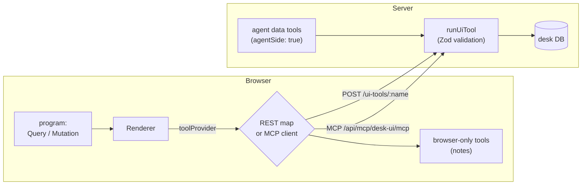

# UI-side tools (Query / Mutation)

!!! abstract
    Generated UI loads and changes data by itself. `Query("list_tickets", {status: $status}, defaults)` fetches when its arguments change. `Mutation(...)` runs when a button fires `@Run`. The browser's `toolProvider` runs both, and the model is not involved.

**Adopt alone?** Yes · **Effort** M · **Touches** client, server, prompt

## The problem

If the agent fetches data and writes it into the UI, the UI is a snapshot: stale the moment it renders, and every refresh costs a model turn. You want the agent to write the **wiring** once and the UI to stay live. You also want writes to happen only on a user's click, through code you validate.

## How the demo does it



### 1. One contract per tool

Each tool is a Zod contract in [`shared/src/ui-tools/contracts.ts`](https://github.com/asafmor/openui-desk/blob/main/shared/src/ui-tools/contracts.ts): name, kind, description, input and output.

```ts
export const listTickets = tool({
  name: "list_tickets",
  kind: "query",
  agentSide: true, // also give it to the agent as a read tool
  description: "Search tickets, newest first. All filters are optional.",
  input: z.object({
    status: StatusFilter.optional(),
    priority: PriorityFilter.optional(),
    search: z.string().optional().describe("Case-insensitive match on title or customer"),
    // …
  }),
  output: z.object({ rows: z.array(Ticket), total: z.number() }),
});
```

The same contract feeds four places:

| Consumer | Uses |
| --- | --- |
| Prompt (`promptOptions.tools` via `toToolSpec`) | name, description, input and output JSON Schema, read-only/destructive hints |
| REST route and MCP server | `input` validates untrusted arguments |
| Agent tools (`agentSide: true`) | the model reads real data during its turn |
| Server handlers (`handle(contract, fn)`) | TypeScript checks the handler against input and output |

### 2. In a program

```text
$status = "open"
tickets = Query("list_tickets", {status: $status, priority: $priority, search: $search}, {rows: [], total: 0})
health  = Query("system_health", {}, {queueDepth: 0, p95LatencyMs: 0, errorRate: 0, checkedAt: ""}, 5)
createTicket = Mutation("create_ticket", {title: $newTitle, customer: $newCustomer, priority: $newPriority})
Button("Create", Action([@Run(createTicket), @Run(tickets), @Reset($newTitle, $newCustomer, $newPriority)]))
```

- `Query(tool, args, defaults, refreshSeconds?)` re-fetches when an argument changes (`$status`), on `@Run(q)`, and every `refreshSeconds`.
- The **defaults** render until data arrives, so `tickets.rows.title` never reads `undefined`.
- `@Run(mutation)` is awaited, and a failed mutation stops the rest of the chain. `createTicket.status` and `createTicket.error` are readable in the program.

### 3. The toolProvider: a function map or an MCP client

The `toolProvider` prop accepts either shape. The header toggle switches them at runtime, and the programs don't change.

=== "Function map (REST)"

    ```ts title="client/src/openui/tool-provider/rest-tools.ts"
    export function createRestTools(): Record<string, ToolFn> {
      return Object.fromEntries(
        SERVER_UI_TOOLS.map((t) => [t.name, (args: Record<string, unknown>) => postTool(t.name, args)]),
      );
    }
    ```

=== "MCP client"

    ```ts title="client/src/openui/tool-provider/mcp-tools.ts"
    export async function connectMcp(): Promise<Client> {
      const client = new Client(
        { name: "openui-desk-browser", version: "1.0.0" },
        { versionNegotiation: { mode: { pin: "2026-07-28" } } },
      );
      await client.connect(new StreamableHTTPClientTransport(new URL(`${SERVER_URL}/api/mcp/desk-ui/mcp`)));
      return client;
    }
    ```

    Any object with `callTool({ name, arguments })` (`McpClientLike`) works. The demo wraps the MCP client so that browser-only tools are served from the same provider.

### 4. The trust boundary

Arguments come from the browser and were chosen by the model, so the server validates them with the contract before touching data:

```ts title="server/src/ui-tools/run-ui-tool.ts"
export function runUiTool(name: string, rawInput: unknown): unknown {
  const contract = SERVER_UI_TOOLS.find((t) => t.name === name);
  if (!contract) throw new UiToolError(`Unknown tool "${name}"`, 404);
  const parsed = contract.input.safeParse(rawInput ?? {});
  if (!parsed.success) throw new UiToolError(`Invalid input for ${name}: …`, 400);
  return UI_TOOL_HANDLERS[name](parsed.data);
}
```

The REST route ([`ui-tools-route.ts`](https://github.com/asafmor/openui-desk/blob/main/server/src/mastra/routes/ui-tools-route.ts)), the MCP server ([`desk-mcp-server.ts`](https://github.com/asafmor/openui-desk/blob/main/server/src/mastra/mcp/desk-mcp-server.ts)) and the agent tools ([`agent-data-tools.ts`](https://github.com/asafmor/openui-desk/blob/main/server/src/mastra/tools/agent-data-tools.ts)) all call `runUiTool`. Only read tools are marked `agentSide`, so writes need a human click.

### 5. Browser-only tools

A tool is any async function in the provider. `list_notes` and `add_note` read and write the workspace itself, so notes work offline and are exported with it ([`local-tools.ts`](https://github.com/asafmor/openui-desk/blob/main/client/src/openui/tool-provider/local-tools.ts)). The model can't tell them apart from server tools.

### 6. Failures

The surface uses the Renderer's slot API to show a banner with a retry button while keeping the UI mounted:

```tsx title="client/src/surfaces/SurfaceView.tsx"
<Renderer.QueryError>
  <div className="surface__query-error" role="alert">
    Some data failed to load. <Renderer.Retry className="ou-btn ou-btn--secondary">Retry</Renderer.Retry>
  </div>
</Renderer.QueryError>
```

## Port it to your app

1. Write one Zod contract per tool, with clear descriptions and an output schema.
2. Server: one endpoint that looks up the contract, `safeParse`s the input, checks permissions and calls the handler. In Mastra, a `registerApiRoute` route is enough.
3. Prompt: pass the contracts as `promptOptions.tools` (convert with `z.toJSONSchema`). See [Prompt generation](prompt.md).
4. Client: `<Renderer toolProvider={{ list_tickets: (args) => post("list_tickets", args), … }}>`.
5. Optional: give read tools to the agent too (same handler, `createTool`), so it can look at real data before it writes UI.
6. Optional: expose the same handlers as a Mastra `MCPServer` and pass an MCP client as `toolProvider`.

## Variations

- **You already have an API.** Point the function map at your existing endpoints. The contracts only need to describe them to the model.
- **No shared client/server package.** Keep contracts on the server. Generate the prompt `tools` there, and give the client only the tool names, or a fetch-by-name function. The client doesn't need the schemas.
- **You already have your own chat and history.** No change. Tool results never enter the conversation; the model only sees programs.
- **Single surface.** Same; one provider serves every Renderer.

## Pitfalls

!!! warning "Never trust Query arguments"
    The model writes them, and anyone can call your endpoint. Validate with the contract, check the user's permissions per tool, and log mutations.

- **Query tools must be safe to repeat.** The Renderer re-runs Queries on mount, reload, import, refresh intervals and retry. A Query with a side effect runs that effect again each time. Put writes in `Mutation`.
- **MCP version pin.** `@mastra/mcp` 2.x speaks MCP `2026-07-28` only. The `@modelcontextprotocol/client` 2.x default negotiation is rejected, so pin it as shown. The server also needs CORS for the `mcp-*` headers.
- **Return `structuredContent` over MCP.** OpenUI's `extractToolResult` prefers it; set `outputSchema` on the Mastra tool.
- **Write defaults that match the output shape.** A non-nullable output (`ticket` with `id: ""`) lets programs read fields before data arrives.
- **Closures over React state go stale.** In `Action([@Run(addNote), @Run(notes)])` the Query re-runs before React re-renders. The demo keeps notes in a ref that `addNote` updates immediately.

## Related

- [Prompt generation](prompt.md)
- [Custom actions & the host](custom-actions.md)
- [Data-shaped UI](data-shaped-ui.md)
- [Proposals (human in the loop)](proposals.md)
- [Runtime diagnostics](diagnostics.md)
