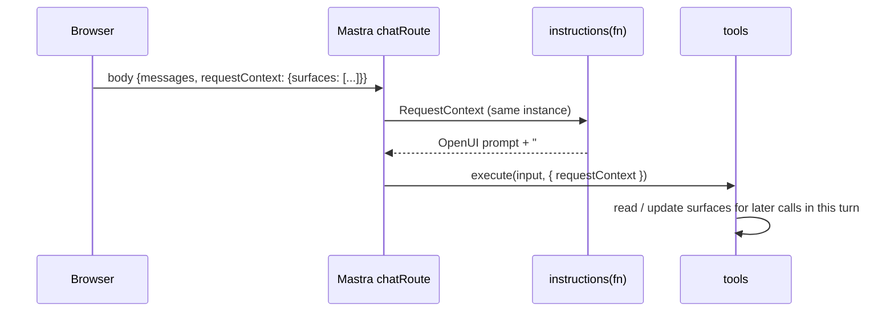

# Live UI context for the agent

> Send the current programs, their live `$state` and their render errors with every chat
> request, so the agent can patch what is on screen instead of guessing.

**Adopt alone?** Yes · **Effort** S · **Touches** client, server

## The problem

An agent can only edit a UI it can see. If the agent's prompt does not contain the
current program, it rewrites everything from scratch, forgets what the user filtered,
and cannot fix errors it never heard about. The conversation history is not enough: the
user changed filters by clicking, and earlier patches may have failed or been undone.

## How the demo does it



**1. The client adds the surfaces to every request.**

```ts
export function createDeskTransport(getSurfaces: () => SurfaceSnapshot[]) {
  return new DefaultChatTransport<UIMessage>({
    api: `${SERVER_URL}/chat`,
    prepareSendMessagesRequest: ({ messages }) => {
      const requestContext: ChatRequestExtras = { surfaces: getSurfaces() };
      return { body: { messages: messages.map(forModel), requestContext } };
    },
  });
}
```

[client/src/chat/chat-transport.ts](https://github.com/asafmor/openui-desk/blob/main/client/src/chat/chat-transport.ts)

A snapshot is `{ id, program, state, errors }`
([chat-request.ts](https://github.com/asafmor/openui-desk/blob/main/shared/src/protocol/chat-request.ts)).
The transport reads it through a ref, so it always sends the latest values.

**2. Mastra turns `body.requestContext` into the agent's `RequestContext`.** The chat
route is plain `chatRoute` from `@mastra/ai-sdk`:

```ts
chatRoute({ path: "/chat", agent: DESK_AGENT_ID, version: "v7" }),
```

[server/src/mastra/index.ts](https://github.com/asafmor/openui-desk/blob/main/server/src/mastra/index.ts)

**3. `instructions` is a function** of that context, so the prompt is rebuilt per request:

```ts
export const deskAgent = new Agent({
  id: DESK_AGENT_ID,
  name: "Desk",
  model: process.env.DESK_MODEL ?? "openai/gpt-6.1-sol",
  instructions: ({ requestContext }) => BASE_SYSTEM_PROMPT + surfaceContext(getSurfaces(requestContext)),
  tools: { ...agentDataTools, update_surface: updateSurface, set_surface_state: setSurfaceState, publish_artifact: publishArtifact },
  defaultOptions: { maxSteps: 14 },
});
```

[server/src/mastra/agents/desk-agent.ts](https://github.com/asafmor/openui-desk/blob/main/server/src/mastra/agents/desk-agent.ts)

**4. `surfaceContext` prints one section per surface**: purpose, program, `$variables`
only (form internals are noise) and render errors with hints.

```ts
return [
  `### surface "${s.id}" — ${meta.title}`,
  `Purpose: ${meta.purpose}`,
  `Program:\n${program}`,
  `Live $state: ${JSON.stringify(bindings)}`,
  `Render errors: ${errors}`,
].join("\n");
```

[server/src/mastra/prompt/surface-context.ts](https://github.com/asafmor/openui-desk/blob/main/server/src/mastra/prompt/surface-context.ts)

**5. Tools keep the context current within one turn.** The same `RequestContext`
instance is passed to every tool. When `update_surface` accepts a patch it stores the
merged program, so a second patch in the same turn builds on the first:

```ts
export function setSurfaceProgram(ctx: RequestContext | undefined, id: string, program: string) {
  if (!ctx) return;
  const next = getSurfaces(ctx).map((s) => (s.id === id ? { ...s, program, errors: [] } : s));
  ctx.set(KEY, next);
}
```

`setSurfaceStateValues` does the same for `set_surface_state`.
[server/src/mastra/request-context.ts](https://github.com/asafmor/openui-desk/blob/main/server/src/mastra/request-context.ts)

## Port it to your app

1. **Build a snapshot** of each UI you want the agent to see:
   `{ id, program, state, errors }`. Keep only `$` keys of the state if size matters.
2. **Send it in `body.requestContext`** of the chat request. With `useChat`, use
   `prepareSendMessagesRequest`. With another client, add the field to the POST body.
3. **Make `instructions` a function** and append a "current UI" section built from
   `requestContext.get(...)`.
4. **Read the same context in tools** through `execute(input, context)` →
   `context?.requestContext`, and update it when a tool changes a UI.
5. **Treat it as untrusted input.** It comes from the browser. Validate ids and programs
   in tools before you rely on them.

!!! warning "Only `requestContext` reaches the agent"
    With Mastra's `chatRoute`, per-request data must be inside `body.requestContext`.
    Other top-level body keys do not reach `instructions` or tools.

## Variations

=== "Own chat & history"

    You may already call a Mastra agent from your own endpoint. Put the snapshot into a
    `RequestContext` and pass it as `options.requestContext` to `agent.stream()` or
    `agent.generate()`. `instructions` and tools then read it exactly as above.
    See [You already have chat & history](../porting/own-chat.md).

    ```ts
    import { RequestContext } from "@mastra/core/request-context";

    const requestContext = new RequestContext();
    requestContext.set("surfaces", body.surfaces);
    const stream = await agent.stream(messages, { requestContext });
    ```

=== "Server owns the UI"

    If programs are stored on the server, load them there instead of trusting the
    browser's copy. Send only the user's live state (or nothing) from the client. See
    [Persisting on the server](../porting/server-persistence.md).

=== "No shared package"

    Define the snapshot type twice (client and server) or generate it from one Zod
    schema. It is a small, stable shape. See
    [No shared client/server package](../porting/no-shared-package.md).

=== "Single surface"

    Send one snapshot and print one section. Drop the surface ids.

## Pitfalls

- **Token cost.** Every request carries every program. Four dashboard programs are a few
  thousand tokens. Ways to reduce it: send only surfaces the user can see, skip empty
  ones, drop form internals (the demo already does), or send a hash and let the server
  keep the last copy.
- **Stale snapshots.** Read the latest state at send time (a ref or a getter), not the
  state captured when the transport was created.
- **The prompt changes per request.** Put the static OpenUI prompt first and the dynamic
  section last, so provider-side prompt caching can reuse the static prefix.
- **Errors are context too.** Sending render errors is what lets the agent fix them. See
  [Fixing errors with the agent](self-correction.md).

## Related

- [Agent edits surfaces](agent-edits.md)
- [Agent drives live state](agent-state.md)
- [Fixing errors with the agent](self-correction.md)
- [Prompt generation](prompt.md)
- [Surface modeling](surfaces.md)
